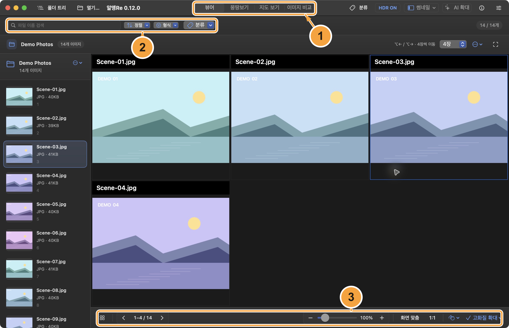
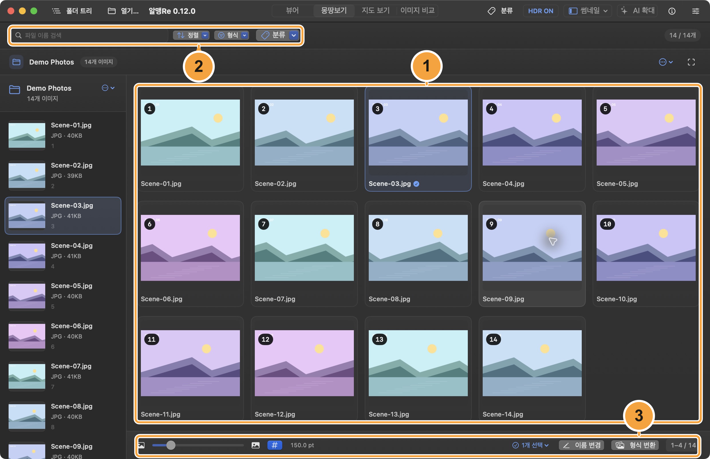
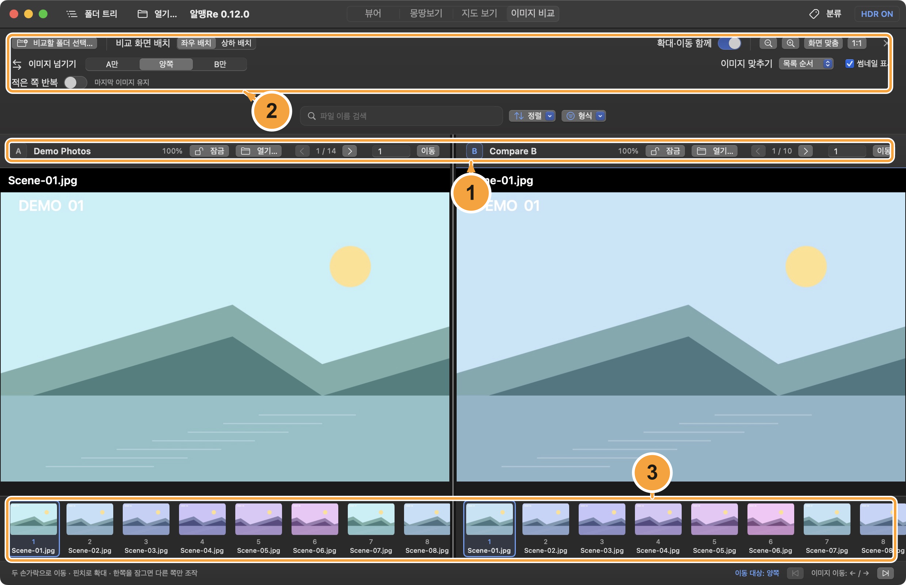
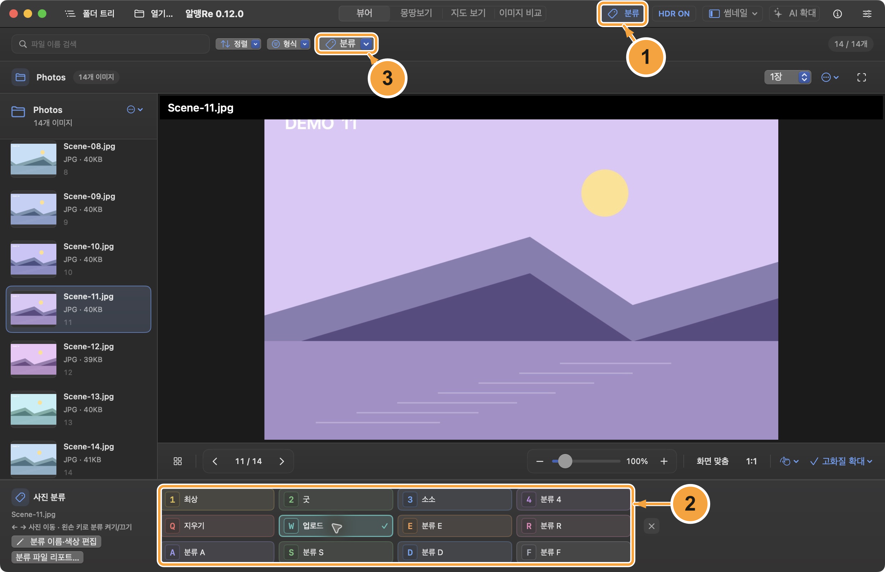
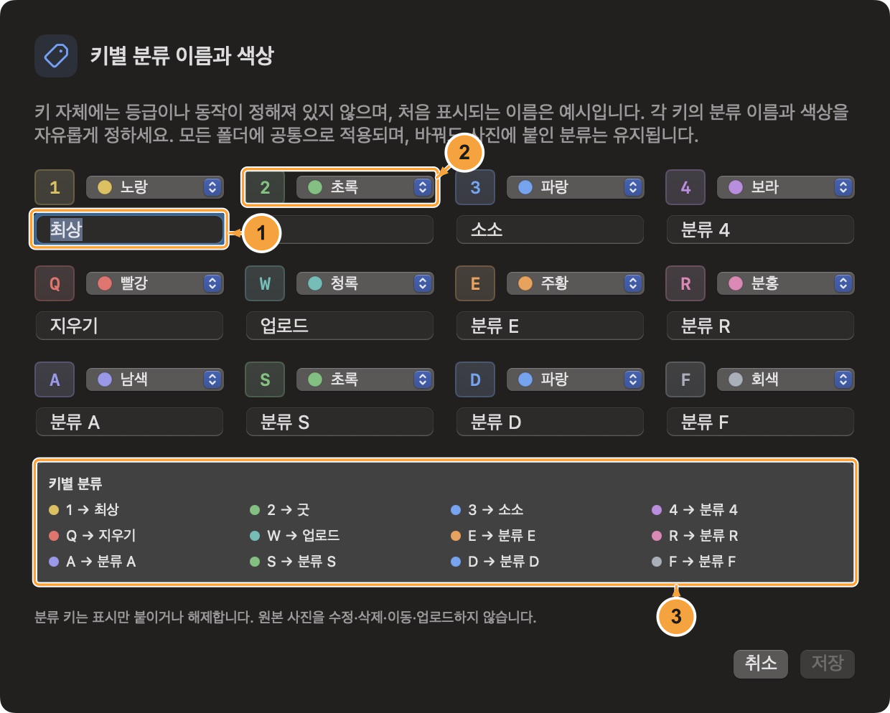
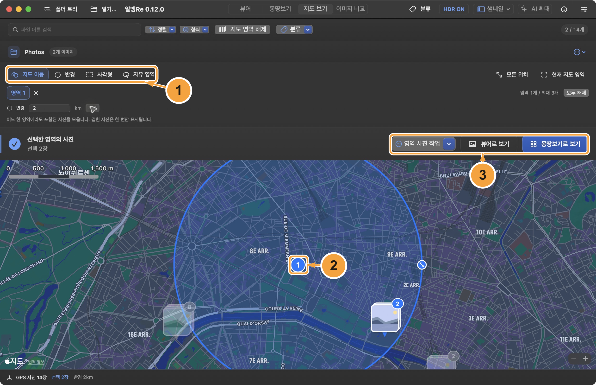
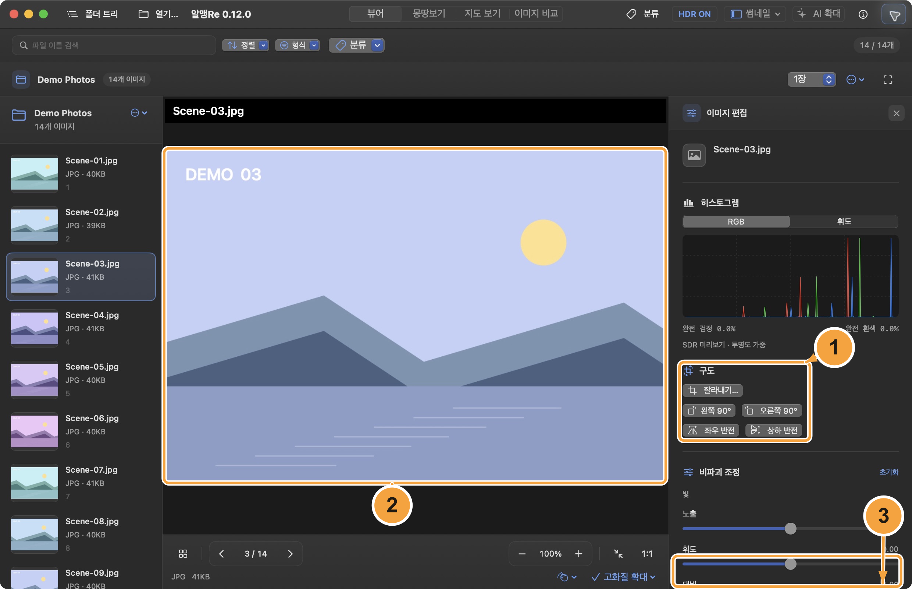
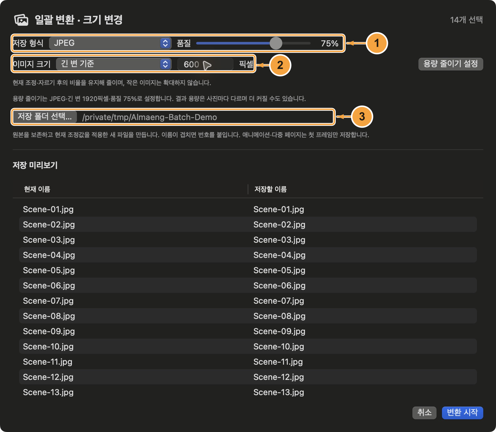
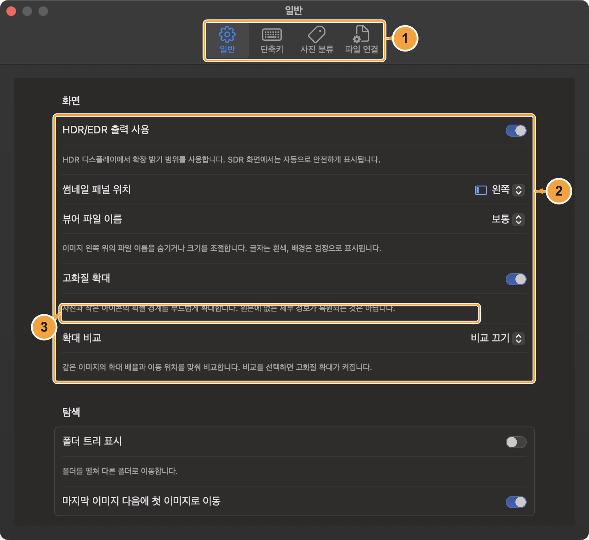
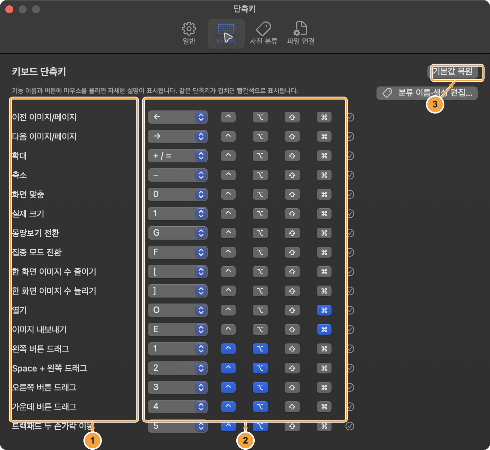

<!-- almeng-guide-source-sha256: a6114a2904db5b3f072ed6bf9e127760419558bbec2a1f2fcdd061d20de37409 -->

# 알맹Re User Guide

[한국어](ko.md) · [English](en.md) · [日本語](ja.md) · [简体中文](zh-Hans.md) · [Français](fr.md) · [Español](es.md) · [Tiếng Việt](vi.md)

[← 알맹Re](../../README.md) · [PDF](pdf/AlmaengRe-User-Guide-en.pdf)

**Open, browse, compare, tag, and edit your images on Mac**

A practical guide to the current 0.12 development version. Start with a folder of images, then use the chapters as a reference for the task in front of you. Menu names in this guide follow the app's English interface.

Version 0.12.0 · As of 2026-10-05

> Screenshots show the real app with a Korean interface and synthetic demonstration images. Numbered annotations and explanations are translated into this guide's language; the screenshot pixels remain unchanged. No personal photo collection is used.

## Contents

- [1. Open images, folders, and ZIP archives](#open)
- [2. Browse and focus on your images](#viewer)
- [3. Find and select images in All at Once](#overview)
- [4. Compare two image collections](#compare)
- [5. Tag photos with the keyboard](#tags)
- [6. Set tag names, colors, and tracking expectations](#tag-editor)
- [7. Find photos by location](#map)
- [8. Inspect image information and metadata](#information)
- [9. Edit an image and export a copy](#editing)
- [10. Batch rename, convert, resize and share](#batch)
- [11. Understand AI enlargement, HDR, and loading](#quality)
- [12. Play a Photo Album or set wallpaper](#slideshow)
- [13. Make the app work your way](#settings)
- [14. Shortcuts and quick troubleshooting](#shortcuts)
- [Shortcuts at a glance](#shortcut-reference)

---

## 1. Open images, folders, and ZIP archives

Use Open… for every kind of input. A single photo, a folder, and a ZIP archive all enter the same browsing workflow.

### How to

1. Launch 알맹Re on macOS 14 or later. Choose Open… on the start screen, toolbar, or File menu, or press ⌘O.
2. Choose a folder to browse its images. Choose one image to start there and continue through other images in the same folder. Selecting several images opens only those selected images.
3. Choose a ZIP archive to view its supported images, including images in nested archive paths. You can also open files from Finder or drag images and folders into the app.

### Folders and favorites

Folder Tree expands folders as needed. Click a folder name to open it, use the upward arrow to go up, and refresh after changes in Finder. Pin a folder above the tree for quick access. Opening a normal folder does not automatically include all its subfolders.

### ZIP is read-only

Images are extracted into a temporary folder while the archive is open. Export a copy before renaming or editing source metadata. The app does not rewrite the ZIP. Stored/Deflate archives are supported; encrypted archives and other compression methods are rejected. Limits include a 2 GiB archive, 10,000 entries, 256 MiB per extracted entry, and 1 GiB total extracted data.

### Return to your place

The app restores the last collection, selected image, viewing mode, and search settings when possible. If a drive is disconnected or access has changed, use Open… again. Editing adjustments and unsaved AI results are not restored.

### Good to know

- Selecting folders and individual images together collects them without duplicates. In Image Comparison, Open… changes the active unlocked A or B pane. Help → Basic Usage opens a short guide inside the app. Help → Detailed User Guide (GitHub) opens the full guide for your language on GitHub in your default browser.

[Back to top](#top)

---

## 2. Browse and focus on your images

Viewer can show one to ten images at a time. Zoom in to inspect details or hide the surrounding controls for a focused view.

**Screen 01.** The main Viewer, with the viewing controls surrounding the image.

1. **View modes** — Switch between Viewer, All at Once, Map View, and Image Comparison.
2. **Find and organize** — Search filenames and use format, tag, and sort controls for the open collection.
3. **Viewing controls** — Move through images, set zoom, change the number displayed, and choose the pan method.

### How to

1. Choose Viewer at the top. Use ← and → to move. Set the number of images per screen with the count control or \[ and \]; the grid adapts to the window's shape.
2. Pinch the trackpad or use = and − to zoom. Press 0 for Fit to Window and 1 for Actual Size. Choose a pan method from the lower controls or Settings → General.
3. Press F, double-click a photo, or briefly tap Space to toggle focus mode. Press Esc to return. Full Screen is a separate command: ⌃⌘F.

### Moving through several images

In the regular viewer, ←/→ advances by the configured number of images per screen. ⌥←/⌥→ also moves a full screen when more than one image is displayed. In Tagging mode, plain arrows move one image at a time while Option-arrow navigation still moves a full screen.

### Pan controls

Choose left drag, Space + left drag, right drag, middle drag, or two-finger trackpad movement. The ⌃⌥1–5 shortcuts select a pan method; they do not move the photo by themselves. Horizontal swipes navigate when the gesture is not being used to pan.

### Focus controls

The lower × hides only the floating control bar. Reopen it from the button beside the filename. The upper × exits focus mode. These buttons remain available even if filename display is hidden. A short Space tap does not change focus while typing or when Space has a custom shortcut.

### Good to know

- Thumbnails can appear on the left, right, top, or bottom, or be hidden. Esc closes the current temporary viewing mode before returning from Viewer to All at Once.

[Back to top](#top)

---

## 3. Find and select images in All at Once

All at Once spreads the current collection into a thumbnail grid. Use it to scan a folder, narrow a selection, and prepare a batch operation.

**Screen 02.** All at Once combines the thumbnail grid with search, selection, and size controls.

1. **Thumbnail grid** — Click, range-select, or drag across cards; double-click to open a photo.
2. **Search and filters** — Narrow the open collection without changing the files.
3. **Size and selection** — Adjust preview size and use the selected-image actions for batch work.

### How to

1. Choose All at Once or press G. Adjust the thumbnail-size slider to see more images or larger previews. Double-click a thumbnail to open it in Viewer.
2. Type in Search Filenames. Search ignores letter case; every space-separated term must appear in the filename. Choose one or more formats, or All Formats to clear that filter.
3. Click to select, ⌘-click to add or remove an image, and ⇧-click to select a range. Drag a rectangle from an image or empty space to select intersecting cards.

### Selection shortcuts

Hold Shift when starting a selection rectangle to add to the existing selection. Hold ⌘ to toggle the images in the rectangle. Esc restores the selection from before that drag. ⌘A selects all images in the current visible list.

### Sort the current list

Sort by name, modification date, creation date, file size, or GPS direction. Name sorting treats 2 before 10. GPS sorting reads location metadata and places images without GPS last. Search, format, tag, and map restrictions work together; none of them changes the original files.

### Numbers and preview size

The # control shows or hides thumbnail numbers. Large badges move outside small photos to keep the image visible. The thumbnail-size setting is remembered; its range is 44.8–665.6 points, with individual cells constrained by the window width.

### Good to know

- Search is by filename, not by objects, image content, or OCR text. If expected images disappear, clear the search and active filters before reopening the folder.

[Back to top](#top)

---

## 4. Compare two image collections

Image Comparison keeps independent A and B collections side by side or above and below. It is useful for comparing versions or checking two folders.

**Screen 03.** Two collections in Image Comparison.

1. **A and B panes** — Each pane has its own image collection and Open… control.
2. **Comparison behavior** — Choose matching, the navigation target, shorter-side looping, and linked zoom.
3. **Locks and thumbnails** — Freeze one side or choose another image from that pane's thumbnail strip.

### How to

1. Choose Image Comparison or press ⌃⌥C. Use Choose Folders to Compare… to select A and B in sequence, or use each pane's Open… button.
2. Use List Order for independent lists. Choose Matching Names to pair filenames without their extensions: 001.jpg matches 001.png. Missing partners stay visible as empty comparison rows.
3. Choose A Only, Both, or B Only under Image Navigation. Use the common arrows or the pane's thumbnails to move. Turn Link Zoom and Pan on to inspect corresponding relative positions.

### Navigation and looping

Choosing A Only or B Only switches to List Order. Matching Names returns to paired navigation. Under Both, Loop Shorter Side repeats the shorter list while the longer one advances; when off, the shorter list stays on its last image. Looping is for List Order.

### Locks

Lock freezes a pane's image, zoom, and pan position. Lock B to navigate A; lock A to navigate B. Unlocking both returns navigation to Both, and locking both stops navigation. A locked pane's thumbnails can still be inspected and scrolled.

### Originals and saved state

Comparison displays originals without the regular viewer's editing adjustments. Exit comparison for editing, batch operations, or wallpaper. Esc returns to the preceding view. Layout, linking, navigation preferences, and the last A/B inputs and positions are remembered.

### Good to know

- ⌥←/⌥→ navigates A only; ⇧⌥←/⇧⌥→ navigates B only. Matching Names ignores extension, letter case, and equivalent Unicode spelling.

[Back to top](#top)

---

## 5. Tag photos with the keyboard

Tagging lets you attach several personal labels to a photo while browsing. Tags are marks in the app, not actions performed on the original file.

**Screen 04.** Tagging mode with keyboard assignments and colored marks.

1. **Tagging mode** — Turn the mode on or off; ordinary viewing keys resume when it is off.
2. **Tag keys** — Use 1–4, QWER, and ASDF, or click a tag button. A photo can carry several marks.
3. **Tags filter** — Gather matching or untagged photos from the currently open collection.

### How to

1. Open photos and click Tagging, use the Photo Tags menu, or press ⌘⇧M. In Image Comparison, tags apply to the active pane's photo.
2. Browse with ← and →. Press the physical 1–4, QWER, or ASDF keys to toggle their tags. Press a key again to remove that tag; several tags can coexist.
3. Exit Tagging with ⌘⇧M, Esc, or the panel's close button. Use the Tags filter to show Any selected tag, All selected tags, or Untagged Photos.

### Keep a steady browsing rhythm

Applying a tag does not automatically advance. While Tagging is active, the filtered list stays in place so several keypresses affect the same image. Filter results refresh when you leave Tagging. Plain arrow keys move a single photo in this mode.

### What the keys mean

The initial names, including Delete and Upload, are examples only. These keys never delete, upload, move, or edit a photo. Rename them for your workflow, such as Print candidate or Editing complete.

### Stored locally

Photo marks, classification names and colors, and tracking history are stored in ~/Library/Application Support/org.openimageviewer.ImageViewer/PhotoMarks.sqlite. They are separate from EXIF/XMP and do not sync to the cloud. Development/demo bundles may use another folder; the report displays the actual storage path.

### Good to know

- Tag keys take priority over regular actions while Tagging is active. For example, 1 and F apply tags instead of Actual Size or focus mode. Exit Tagging to use those normal shortcuts again.

[Back to top](#top)

---

## 6. Set tag names, colors, and tracking expectations

Give the twelve tag keys names that fit your work. The same assignments apply across folders, and existing memberships remain attached when a name changes.

**Screen 05.** The shared editor for tag names and colors.

1. **Names by key** — Each fixed key gets an editable name; the names are shared by every folder.
2. **Colors** — Choose a consistent visual cue from the ten-color palette.
3. **Preview and save** — Check the assignments, then save the changes to keep them for the next session.

### How to

1. Open Settings → Photo Tags, or choose Photo Tags → Edit Tag Names & Colors…. You can edit assignments before opening photos.
2. Enter a name for each key and choose one of ten colors. The Key Assignments preview shows the result as you type.
3. Click Save to apply names and colors everywhere. Revert Changes in Settings restores the last saved assignments; Cancel closes the separate editor without saving.

### Consistent visual marks

Colors appear in the tag panel, menus, filters, and thumbnail badges. A checkmark and selected background also indicate membership, so color is not the only cue. Changing a name or color does not clear tags already applied to photos.

### Renames and moves

Saved macOS bookmarks and file identity follow name/location changes on the same volume. In-app renames preserve classifications. External changes are checked at launch, when opening Classification File Report… or refreshing it; there is no continuous watcher. The report retains relocated, unavailable and recovered observations, including classifications, paths and observation time. ZIP photos use the archive identity and internal path. Reopen or refresh the affected folder to update the photo list after an external move.

### Limits of tracking

Unavailable does not confirm deletion: a disk may be disconnected or access denied, so marks and history remain. Copies and different files at the same path do not inherit marks. Cross-volume moves or replacement by a newly created file may not reconnect automatically. Open older path-based marks at their original location once before moving.

### Good to know

- The app does not search the whole disk for missing photos or analyze their contents. Keep important originals and the app's local data backed up as part of your normal Mac backup.

[Back to top](#top)

---

## 7. Find photos by location

Map View places photos with GPS metadata on a map. Combine up to three areas to browse images from several places together.

**Screen 06.** Map View with selectable areas and a matching-photo summary.

1. **Area tools** — Add a radius, rectangle, freehand boundary, or the current map extent.
2. **Area handles** — Move and resize an active area; combine at most three areas.
3. **Browse the results** — Open matching photos in Viewer or All at Once while keeping the area filter. On the map, area and pin actions also offer rename, conversion and sharing directly.

### How to

1. Open a collection and choose Map View. Nearby photos are grouped into stacked thumbnails with a count. Click a location to preview its images and use View Photo to open one.
2. Choose Radius or Rectangle to add an area at the current map center. Drag its numbered handle to move it and the small size handle to resize it. A radius can also be entered in kilometers.
3. Choose Freehand Area and draw a boundary, or add Current Map Area. Add up to three areas, then use Open in viewer or Open in overview to browse the matching photos; the latter opens All at Once. On the map, area and pin actions also offer rename, conversion and sharing directly.

### Combine and edit areas

A photo in any selected area is included once, even where areas overlap. Select Area 1, 2, or 3 to edit it, use its × to remove it, or clear all areas. Esc cancels a freehand drawing or reverts a move or resize in progress.

### Keep the selected collection

Opening the selection in Viewer or All at Once keeps the map restriction active. Filename, format, and tag filters also apply. Clear Map Area returns to the non-geographic filtered list, including images without GPS. Opening a map photo outside the selection clears only the geographic restriction.

### Loading and saved state

Map backgrounds need an internet connection. Photos without GPS do not appear as map thumbnails. Location reads may take time in a large collection. Areas are restored with the last session; opening a new folder clears the previous area's selection.

### Good to know

- If no photos match, enlarge or move the area and check other filters. The buttons for opening a selection are unavailable while results are loading or empty.

[Back to top](#top)

---

## 8. Inspect image information and metadata

The circular i button remains Image Information. It shows details of the current photo; the app's own story is under Help → About.

### How to

1. Select a photo and click the circular i button, or use Navigate → Image Information Panel.
2. Inspect file size, dimensions, color information, and available camera/EXIF data. If GPS is present, the panel shows an Apple map; Google Maps opens the same coordinates externally.
3. To change supported file or embedded fields, open Edit Image Information, revise the values, and review them before Save.

### Metadata saving changes the file

Unlike visual adjustments, metadata edits are written back to the source file. Editable fields include filename, modification date, description, rights, DPI, camera details, and GPS when the format supports them. The editor prepares a temporary file before replacing the source path. Unsupported embedded fields are disabled; ZIP members are read-only.

### Removing or correcting values

Emptying an editable text value removes that tag when saved. Turning off GPS removes standard EXIF/XMP location tags. Coordinates need both latitude and longitude. Changing an extension does not convert an image; use Export or Batch Format, Resize & Compress for that.

### Read the histogram correctly

RGB and luminance histograms describe an SDR preview, weighted by transparency, and follow editing adjustments. Black and white percentages count preview pixels with all RGB channels at 0 or 255. This is not a RAW sensor histogram or a measurement of the original HDR brightness range.

### Good to know

- Keep a copy before making metadata changes you may want to undo. The i icon is for the photo; Help → About opens the app introduction and license information.

[Back to top](#top)

---

## 9. Edit an image and export a copy

Image Editing previews changes without overwriting the original. Export the result before quitting: visual adjustments are kept only for the current app session.

**Screen 07.** The editing panel beside a preview of the current image.

1. **Editing controls** — Crop, rotate, flip, and adjust tone, color, and detail.
2. **Image preview** — Inspect the current result; use Actual Size for detail adjustments.
3. **Export — below the panel** — Scroll down the editing panel or press ⌘E to save a copy before closing the app.

### How to

1. Select a photo and click the slider-shaped Image Editing button. Opening it from All at Once switches to Viewer for that photo.
2. Crop by dragging a rectangle on the image. Move it from inside, resize its corners, or enter a ratio and dimensions. Apply the crop; canceling the crop sheet keeps previous edits. Rotate in 90° steps or use Flip Horizontal / Flip Vertical.
3. Adjust light, color, and detail controls. Choose an available output format and quality in the editing panel, then click Export… or press ⌘E to save a new file.

### Adjustments

Use exposure, brightness, contrast, highlights, shadows, black point, and whites for tone; hue, temperature, vibrance, and saturation for color. Tone curves offer RGB or individual channels with five points. The eight-color mixer adjusts hue, saturation, and lightness for each color. Texture, clarity, dehaze, and film looks provide further control.

### Reset and inspect

Reset removes every visual adjustment on the current photo. Remove Crop keeps other edits. Clicking the same flip button again reverses that flip. Check sharpening and noise reduction at Actual Size and in the exported result.

### Save before exit

Each photo keeps its adjustments while the app remains open. The next launch does not restore them. Export defaults to a name ending in -edited, and saving over the source is blocked. Available formats depend on the encoders supplied by macOS.

### Good to know

- Image Comparison shows originals and does not bring in these adjustments. AI Upscaling also uses the source image without the viewer's edits; export an edited copy first if you want to upscale that result.

[Back to top](#top)

---

## 10. Batch rename, convert, resize and share

Select photos in the viewer, overview or a classification-filtered list, then use selection actions, the context menu or Image menu. Map actions target an area or a pin. Renaming changes originals; conversion and resizing create copies.

**Screen 08.** The batch dialog converts selected photos and resizes them proportionally.

1. **Format and quality** — Choose output format and lossy quality, or start with the compression preset.
2. **Proportional resizing** — Choose a longest edge or percentage. Smaller images are not enlarged.
3. **Destination and preview** — Review the copy folder and filenames before converting.

### How to

1. Use ⌘-click, ⇧-click or ⌘A in thumbnails; the overview also supports rectangle selection. Filter by classification and select all, or use Area Photo Actions, This Photo or All Photos at This Location on the map.
2. Open Batch Rename… and choose to keep, replace or find and replace names, or Use a classification name. Explicitly choose the classification to use, then review the matching count and before/after filenames before applying.
3. Open Batch Format, Resize & Compress… and set the format, quality, size and destination folder. Review and convert. Share Files… passes selected originals to the native macOS sharing menu; the result sharing button passes only successfully exported copies.

### Classification names and sequence numbers

Only selected files carrying the chosen classification are renamed, in current list order: Upload01, Upload02. At 100 targets, numbering starts at Upload001 and expands further as needed. For photos with several classifications, the one you explicitly choose is used. Ordinary numbering defaults to two digits, with configurable start, increment, padding and separator. Empty classification names, duplicate or invalid destinations block applying. ZIP members cannot be renamed in place.

### Real format conversion and proportional resizing

Rename extension options change casing or equivalent spellings such as .jpg/.jpeg; use batch conversion for another encoding. Resize by longest edge or 1–100% after existing crop, rotation and adjustments, preserving aspect ratio. Smaller images are never enlarged. The compression preset chooses JPEG, 1920px longest edge and 75% quality. Smaller files or a specific byte count are not guaranteed.

### Saving copies and macOS sharing

Original files and classifications remain intact; new copies do not inherit classifications. Output collisions get a numeric suffix. Animation and multipage inputs save only the first frame. Completed files remain after cancellation, and the result shows saved, failed and unprocessed counts. Available sharing services and limits depend on macOS. To share the current edits, export copies and share from the result.

### Good to know

- Select All applies to the current search, format, classification and map filters. Map actions target the area or pin named by the menu. Check the count and preview before renaming originals.

[Back to top](#top)

---

## 11. Understand AI enlargement, HDR, and loading

High-Quality Zoom changes display interpolation. AI Upscaling creates a larger image you can save. HDR output is a display preference, not a label that proves a photo is HDR.

### How to

1. For smoother display, turn on High-Quality Zoom. Its side-by-side or top-and-bottom comparison shows the same photo with linked zoom and pan; Esc closes that comparison.
2. For a new 2× image, select a photo, open AI Upscaling…, and click Start AI Upscaling. Inspect Compare with Original and Actual Pixels, then Save PNG Copy….
3. Use HDR ON / HDR OFF to allow or disable extended-range display. In Settings → General → Image Loading, choose Priority, Comfortable, Normal, or Slow for your workload.

### AI output and limits

The bundled model runs locally through Core ML; photos are not uploaded and no model download is needed during use. Width and height are doubled. Output is 8-bit SDR sRGB PNG, with separately interpolated transparency. Animated input uses the first frame and viewer edits are not included. The output limit is at most 64 million pixels and can be lower on low-memory Macs. Save before closing; AI detail is an estimate.

### Formats and performance

Reading and writing support depend on the running macOS. The app adds QOI and common PCX decoding, plus an SVG/SVGZ fallback. BPG and .clip are not included. Comfortable is the default loading mode. Every mode slows down for memory pressure, heat, low power, other apps, or slower storage.

### Good to know

- During rapid navigation, a small preview or the previous photo can remain visible until the final image is ready. AI 4×, HDR AI output, and batch AI upscaling are not provided.

[Back to top](#top)

---

## 12. Play a Photo Album or set wallpaper

Photo Album automatically advances through the current list in a focused single-image view. Wallpaper uses a separate copy prepared for the chosen displays.

### How to

1. Open a list with at least two photos. Choose Navigate → Photo Album → Play Photo Album or press ⌃⌥P.
2. Use the playback controls to pause. Choose an interval of 1–300 seconds and whether to repeat, either from the time control or Settings → General → Photo Album.
3. To set wallpaper, return to the regular viewer and choose Image → Set Current Image as Wallpaper… or press ⌃⌥W. Select the current or all connected displays, Fill or Fit, and whether to apply current adjustments; then apply.

### Playback behavior

The default interval is five seconds with repeat on. Timing starts after a preview or image is displayed, so loading time does not consume the viewing interval. Manual navigation or an interval change restarts the timer. With repeat off, playback stops on the final image.

### Automatic pauses

Playback pauses when leaving focus mode, switching to another app, sleeping, or starting file work. The display is kept awake only during playback. Relaunch restores settings but never starts the album automatically.

### Wallpaper copies

The app creates a PNG without altering the source. Animated input uses the first frame and HDR is prepared as SDR. Copies exclude EXIF/GPS, are sized for the display up to 8192 pixels, and remain in the app's Application Support/Wallpapers folder. Other desktop Spaces follow macOS behavior. Previous copies are not automatically deleted because another Space may still use them.

### Good to know

- If playback is unavailable, check that the current filtered list contains at least two photos and that Tagging, Image Comparison, or another operation is not active.

[Back to top](#top)

---

## 13. Make the app work your way

Settings groups everyday viewing choices, custom shortcuts, tag assignments, and default file associations. Many viewing choices return automatically at the next launch.

**Screen 09.** Settings keeps the main preferences in four tabs.

1. **Settings tabs** — General, Shortcuts, Photo Tags, and File Associations each cover a different task.
2. **Viewing preferences** — Set display, thumbnail, filename, navigation, and loading choices.
3. **Inline explanations** — Read the text below a control or hover over it for details about its behavior.

### How to

1. Open 알맹Re → Settings…. In General, choose HDR/EDR output, thumbnail position, filename size, high-quality zoom, folder-tree visibility, and whether navigation wraps.
2. Use Photo Tags to save shared names and colors, and Shortcuts to choose keys and modifier combinations. Hover over controls for explanations.
3. For Finder to open selected formats with this app, place 알맹Re.app in a stable location such as Applications, open File Associations, select only the desired format groups, and apply.

### Language

The interface follows the language assigned to the app by macOS. Change it in System Settings → General → Language & Region → Applications. The app supports Korean, English, Simplified Chinese, Japanese, French, Spanish, Arabic, and Vietnamese; this guide set covers seven languages.

### Remembered preferences

Thumbnail size, high-quality zoom, filename display, loading preferences, favorites, tag settings, and custom keys are retained. The last collection and viewing position can be restored if the files remain accessible. Magnification-quality comparison starts off after relaunch. Visual editing adjustments and AI results must be exported separately.

### File associations

Only the checked format groups are changed. macOS may ask for confirmation. Moving the app later or keeping older copies can cause Finder to open the wrong version; reapply associations from the version you intend to use.

### Good to know

- General also lists the native formats available on your Mac and offers Clear Image Cache. Choose a slower loading mode if you want less background work while using other apps.

[Back to top](#top)

---

## 14. Shortcuts and quick troubleshooting

The reference that follows lists the app's default action keys and fixed contextual keys. ⌘ means Command, ⌥ Option, ⌃ Control, and ⇧ Shift.

**Screen 10.** The Shortcuts tab shows configurable actions and conflict feedback.

1. **Actions** — Hover over an action name to learn where and how it works.
2. **Keys and modifiers** — Choose the key, then toggle Control, Option, Shift, or Command.
3. **Conflicts and defaults** — Resolve duplicate combinations or use Restore Defaults to start over.

### How to

1. Open Settings → Shortcuts to change an action's key and modifiers. Changes are saved and current assignments appear in menus.
2. Check conflict indicators when assigning the same combination to more than one action. Hover over the action, key picker, modifier, or conflict icon for help. Restore Defaults resets the configurable action keys.
3. If a key behaves unexpectedly, leave a text field and check the current mode. Tagging uses its twelve keys for tags; Image Comparison gives Option arrows their A/B navigation meaning.

### No images or no matches

Clear search, format, tag, and map filters. Check that the input format is readable on this macOS. An empty folder can still be opened so you can navigate its subfolders. Reopen a disconnected drive or moved collection with Open….

### A command is disabled

Finish or cancel the current file operation first. Exit Image Comparison for editing, batch conversion, or wallpaper. ZIP members cannot be renamed or have source metadata rewritten. Map result buttons wait for a nonempty, fully calculated selection.

### Space, Esc, and Option arrows

Space is a focus gesture only when no custom action uses plain Space and you are not typing. Esc unwinds the active mode or cancels a selection gesture. Viewer Option-arrow page navigation is fixed but yields to a custom regular-viewer action assigned to that combination.

### Good to know

- The circular i and slider buttons open photo information and editing. Use the buttons or Navigate menu; I and E are not default panel-toggle shortcuts in this version.

[Back to top](#top)

---

## Shortcuts at a glance

| Keys | Action | When it applies |
| --- | --- | --- |
| ← / → | Previous / next image or page | Configurable. Viewer moves by images per screen; comparison follows A Only / Both / B Only. |
| ⌥← / ⌥→ | Previous / next viewer page | Fixed contextual keys when Viewer shows multiple images, including during Tagging; custom viewer assignments take priority. |
| = / − | Zoom in / out | Configurable; applies to the regular viewer or active comparison view. |
| 0 / 1 | Fit to Window / Actual Size | Configurable. Plain 1 is a tag key while Tagging is active. |
| G | Toggle All at Once | Configurable viewing action. |
| F | Toggle focus mode | Configurable. Plain F is a tag key while Tagging is active. |
| Space (tap) | Toggle focus mode | Viewer gesture; inactive while typing or when a custom action uses Space. Holding Space for a pan gesture does not toggle focus. |
| ⌃⌘F | Toggle Full Screen | Fixed app-menu shortcut; separate from focus mode. |
| \[ / \] | Show fewer / more images per screen | Configurable; range 1–10 in Viewer. |
| ⌘O | Open images, folders, or ZIP archives | Configurable; in comparison, opens in the active unlocked pane. |
| ⌘E | Export current image | Configurable; regular viewer workflow, unavailable in Image Comparison. |
| ⌃⌥1 | Select left-drag panning | Configurable; selects a pan method rather than moving the image. |
| ⌃⌥2 | Select Space + left-drag panning | Configurable pan-method selection. |
| ⌃⌥3 | Select right-button panning | Configurable pan-method selection. |
| ⌃⌥4 | Select middle-button panning | Configurable pan-method selection. |
| ⌃⌥5 | Select two-finger trackpad panning | Configurable pan-method selection. |
| ⌃⌥A | Toggle High-Quality Zoom | Configurable display setting; does not alter exported files. |
| ⌃⌥6 / ⌃⌥7 | Compare zoom quality side by side / top and bottom | Configurable; two renderings of the same image in Viewer. |
| ⌃⌥0 | End zoom-quality comparison | Configurable; Esc also closes this comparison. |
| ⌃⌥P | Play / pause Photo Album | Configurable; needs at least two photos and an available regular-viewer workflow. |
| ⌃⌥W | Set current image as wallpaper | Configurable; opens wallpaper options outside Image Comparison. |
| ⌃⌥C | Enter / leave Image Comparison | Configurable; keeps the preceding regular-viewer collection. |
| ⌥← / ⌥→ | Previous / next in A only | Configurable comparison action; A is left or top. A locked pane stays fixed. |
| ⇧⌥← / ⇧⌥→ | Previous / next in B only | Configurable comparison action; B is right or bottom. A locked pane stays fixed. |
| ⌘⇧M | Toggle Tagging mode | Fixed app-menu shortcut. |
| 1 2 3 4 · Q W E R · A S D F | Toggle the twelve photo tags | Fixed physical key positions; Tagging only. Names and colors are editable; keys do not delete or upload files. |
| ← / ↑ · → / ↓ | Previous / next photo while tagging | Fixed Tagging navigation; moves one photo at a time. |
| ⌘A | Select all images in the current list | Fixed selection shortcut outside Image Comparison; text fields retain normal text selection. |
| Esc | Cancel the current gesture or leave the active mode | Fixed. Exits Tagging, comparison, zoom-quality comparison, or focus; regular Viewer returns to All at Once. Also cancels area-selection gestures. |

[Back to top](#top)
