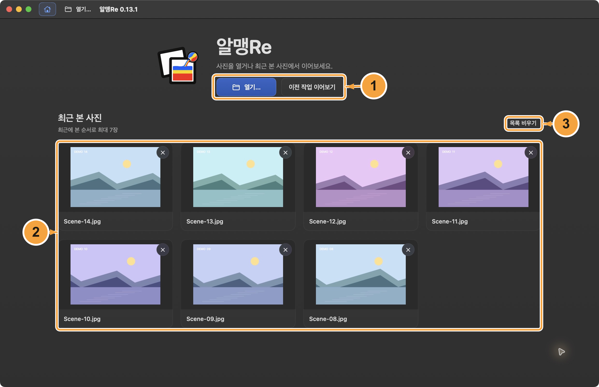
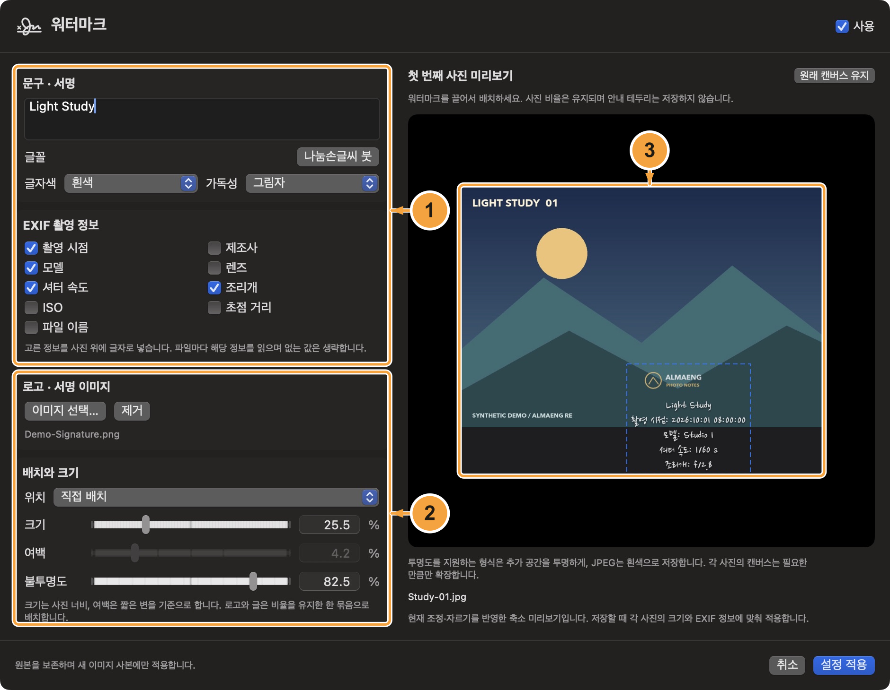
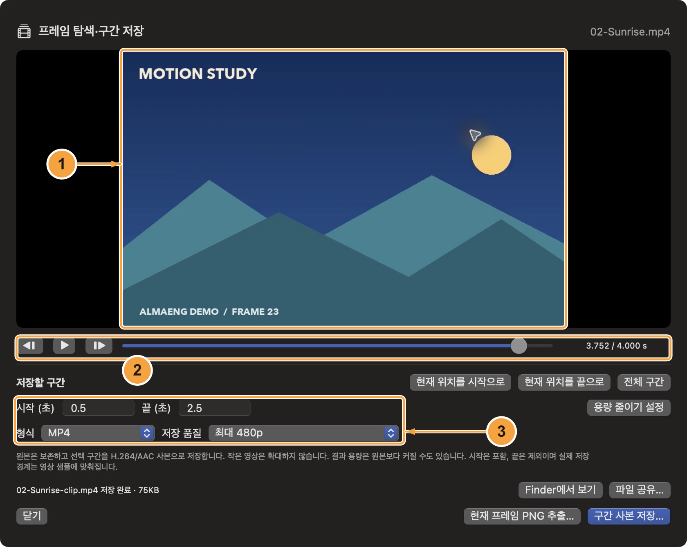
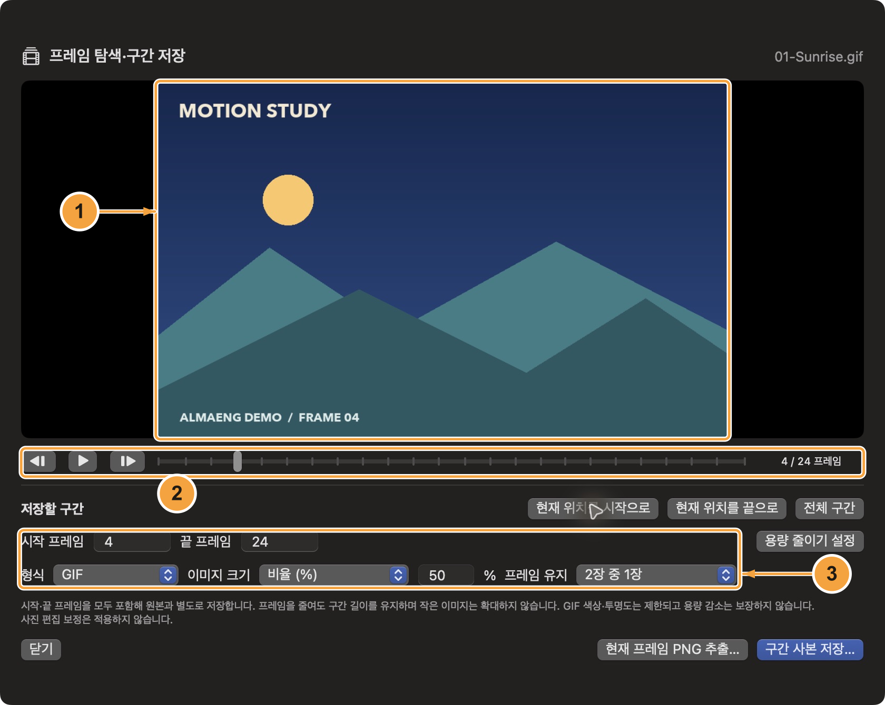
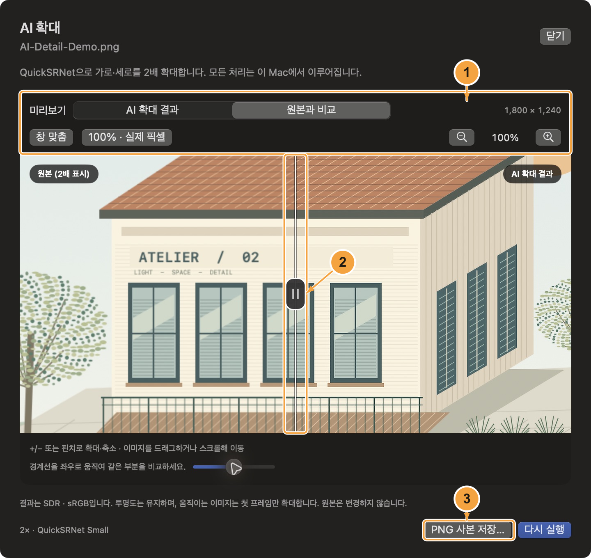

<!-- almeng-guide-source-sha256: ba8bd3ca1c2a2f0516ebc914f6a9e501d6a6c5092c64f3fff1db7b451cad3c61 -->

# 알맹Re 사용설명서

[한국어](ko.md) · [English](en.md) · [日本語](ja.md) · [简体中文](zh-Hans.md) · [Français](fr.md) · [Español](es.md) · [Tiếng Việt](vi.md)

[← 알맹Re](../../README.md) · [PDF](pdf/AlmaengRe-User-Guide-ko.pdf)

**맥에서 이미지를 열고, 둘러보고, 비교하고, 분류하고, 편집하기**

현재 0.13.1 개발 버전을 기준으로 작성한 사용설명서입니다. 이미지 폴더를 여는 것부터 시작해, 하려는 작업에 맞는 장을 찾아보세요. 본문의 메뉴 이름은 앱의 한국어 화면을 따릅니다.

버전 0.13.1 · 기준일 2026-10-09

> 스크린샷은 직접 만든 데모 이미지를 실제 앱의 한국어 화면에서 연 모습입니다. 번호 주석과 설명은 설명서 언어에 맞춰 제공하며, 스크린샷의 원래 화면은 바꾸지 않습니다. 개인 사진 보관함은 사용하지 않았습니다.

## 목차

- [1. 이미지·폴더·ZIP 열기](#open)
- [2. 사진 둘러보기와 집중 보기](#viewer)
- [3. 몽땅보기에서 찾고 선택하기](#overview)
- [4. 두 이미지 목록 비교하기](#compare)
- [5. 사진·영상을 분류하기](#tags)
- [6. 분류 이름·색상과 이동 추적](#tag-editor)
- [7. 위치로 사진 찾기](#map)
- [8. 이미지 정보와 메타데이터 확인](#information)
- [9. 사진 편집하고 사본 저장하기](#editing)
- [10. 여러 사진 이름·형식·크기 바꾸기와 공유](#batch)
- [11. 문구·EXIF·로고 워터마크 넣기](#watermark)
- [12. 영상 재생과 프레임·구간 저장](#video)
- [13. 움직이는 이미지의 프레임 추출과 축소](#animation)
- [14. AI 확대 결과를 확대하고 비교하기](#ai-upscaling)
- [15. 확대 품질·HDR·로딩 이해하기](#quality)
- [16. 전자 앨범과 바탕화면](#slideshow)
- [17. 내 방식대로 설정하기](#settings)
- [18. 단축키와 빠른 문제 해결](#shortcuts)
- [단축키 한눈에 보기](#shortcut-reference)

---

## 1. 이미지·폴더·ZIP 열기

열기…로 사진·영상·폴더·ZIP을 엽니다. 폴더의 사진과 지원 영상은 기본으로 함께 표시하며 ZIP에서는 이미지만 읽습니다.

**화면 01.** 앱 로고와 열기 버튼, 최근 본 사진을 모은 처음 화면입니다.

1. **열기와 이어보기** — 열기…로 새 목록을 열거나 이전 작업 이어보기로 저장된 작업을 다시 봅니다.
2. **최근 본 사진 7장** — 뷰어·이미지 비교에서 본 사진을 최근 순서로 최대 7장 표시하며 클릭하면 다시 엽니다. 일반 이미지·GIF·ZIP 내부 사진을 포함하고 영상은 제외합니다.
3. **최근 목록 정리** — 각 사진의 목록에서 제거 또는 목록 비우기는 기록만 지우며 원본 파일을 삭제하지 않습니다. 나중에 다시 보면 목록에 다시 나타날 수 있습니다.

### 사용 순서

1. macOS 14 이상에서 알맹Re를 실행하면 처음 화면이 나타납니다. 열기…(⌘O)로 파일을 선택하거나 최근 사진을 클릭합니다. 툴바·파일 메뉴에서도 열기…를 사용할 수 있습니다.
2. 폴더를 선택하면 그 안을 둘러봅니다. 사진 한 장을 열면 같은 폴더의 다른 파일도 이어서 볼 수 있고, 여러 파일을 선택하면 그 파일만 엽니다. 영상 표시는 기본 켜짐이며 선택을 기억합니다. 영상 파일을 직접 열면 자동으로 켜집니다.
3. ZIP을 선택하면 압축 내부의 지원 이미지가 열리며, 하위 경로의 이미지도 포함합니다. Finder에서 파일을 열거나 이미지·폴더를 앱 안으로 끌어다 놓아도 됩니다.

### 폴더 트리와 즐겨찾기

폴더 트리는 펼친 단계만 읽습니다. 폴더 이름으로 해당 폴더를 열고, 위쪽 화살표로 상위 위치로 이동하며, Finder에서 바뀐 내용은 새로고침으로 반영합니다. 자주 쓰는 폴더는 트리 위에 고정하세요. 일반 폴더를 열 때 모든 하위 폴더의 사진을 자동으로 모으지는 않습니다.

### ZIP은 읽기 전용

압축 파일을 열어 둔 동안 이미지를 임시 폴더에 해제합니다. 이름이나 원본 메타데이터를 바꾸려면 먼저 사본으로 내보내세요. ZIP 자체는 다시 저장하지 않습니다. Stored/Deflate 압축을 지원하며 암호화 ZIP과 다른 압축 방식은 오류로 알립니다. 압축 파일 2 GiB, 항목 1만 개, 해제 크기 항목당 256 MiB·전체 1 GiB 등의 제한이 있습니다. ZIP 내부 영상은 제외합니다.

### 처음 화면과 이전 작업

일반 실행은 처음 화면에서 시작합니다. 이전 작업 이어보기로 마지막 목록·선택·보기 모드·검색 조건을 가능한 범위에서 복원합니다. 툴바·메뉴의 처음 화면은 현재 작업을 유지한 채 돌아갑니다. Finder 등에서 파일을 열면 바로 해당 파일로 이동합니다. 연결·접근 권한이 바뀌면 열기…로 다시 선택하세요. 편집 보정값과 저장하지 않은 AI 결과는 재실행 때 복원하지 않습니다.

### 알아두세요

- 폴더와 개별 이미지를 함께 선택하면 중복 없이 모읍니다. 이미지 비교에서는 열기…가 선택된 A/B 중 잠기지 않은 칸에 적용됩니다. 도움말 → 기본 사용법은 앱 안에서 간단한 안내를 엽니다. 도움말 → 상세 사용설명서 (GitHub)는 해당 언어로 된 GitHub의 전체 설명서를 기본 브라우저에서 엽니다.

[맨 위로](#top)

---

## 2. 사진 둘러보기와 집중 보기

뷰어는 한 화면에 1~10장을 표시합니다. 세부를 확대해 살펴보거나 주변 조작부를 숨기고 사진에 집중할 수 있습니다. 여러 장 보기의 영상은 정지 미리보기로 시작하고 마우스를 올리면 무음으로 재생합니다.

**화면 02.** 사진과 영상을 여러 장 함께 표시한 뷰어입니다. 영상에 마우스를 올려 무음으로 미리 볼 수 있습니다.

1. **보기 모드** — 뷰어·몽땅보기·지도 보기·이미지 비교 사이를 전환합니다.
2. **검색·필터와 영상 표시** — 현재 목록의 검색·형식·분류·정렬과 영상 표시를 조절합니다.
3. **보기 조작부** — 항목을 넘기고 표시 개수를 바꿉니다. 사진의 배율과 확대 이미지 이동 방식도 정합니다.

### 사용 순서

1. 상단에서 뷰어를 선택합니다. ←와 →로 이동하고, 장수 조작부나 \[와 \]로 한 화면의 이미지 수를 정합니다. 창의 모양에 맞춰 배치가 자동으로 바뀝니다.
2. 트랙패드를 오므리거나 벌리거나 =와 −로 확대·축소합니다. 0은 화면 맞춤, 1은 실제 크기입니다. 하단 조작부 또는 설정 → 일반에서 확대 이미지 이동 방식을 고릅니다.
3. F, 사진 더블클릭, 짧게 누른 Space로 집중 보기를 켜고 끕니다. Esc로도 돌아올 수 있습니다. 전체 화면은 별도 기능이며 ⌃⌘F를 사용합니다.

### 여러 장씩 넘기기

일반 뷰어에서 ←/→는 설정한 한 화면 장수만큼, 분류 ON에서는 한 항목씩 이동합니다. 여러 장 보기에서 ↑/↓는 현재 화면 안의 위·아래 행을 선택하며 첫·마지막 행에서는 멈춥니다. 짧은 마지막 행은 가장 가까운 카드를 선택합니다. ⌥←/⌥→는 분류 중에도 한 화면씩 넘깁니다.

### 확대한 사진 이동

왼쪽 드래그, Space+왼쪽 드래그, 오른쪽 버튼, 가운데 버튼, 트랙패드 두 손가락 이동 중에서 고릅니다. ⌃⌥1~5는 이동 방식을 선택하는 키이며 사진을 직접 움직이지 않습니다. 가로 스와이프는 해당 동작이 사진 이동에 쓰이지 않을 때 이전·다음 사진을 넘깁니다. 드래그 중에도 사진 가장자리에는 작은 여유만 허용해 큰 빈 공간으로 밀려나지 않게 합니다. 표시 칸보다 작은 축은 중앙에 유지하고 창 크기·배율을 바꾸면 이동 경계를 다시 맞춥니다. 여러 장 뷰어와 확대 품질 비교에도 같은 기준이 적용됩니다.

### 집중 보기 조작부

하단 ×는 떠 있는 조작창만 숨깁니다. 파일명 옆 버튼으로 다시 열 수 있습니다. 상단 ×는 집중 보기 자체를 종료합니다. 파일명을 숨겨도 이 버튼들은 남습니다. 입력 중이거나 Space에 사용자 지정 단축키가 있으면 짧은 Space로 집중 보기를 바꾸지 않습니다.

### 알아두세요

- 썸네일은 왼쪽·오른쪽·위·아래에 두거나 숨길 수 있습니다. Esc는 현재 임시 보기 모드부터 닫으며, 일반 뷰어에서는 몽땅보기로 돌아갑니다.

[맨 위로](#top)

---

## 3. 몽땅보기에서 찾고 선택하기

몽땅보기는 현재 목록을 썸네일 격자로 펼칩니다. 폴더를 훑어보고 대상을 추린 뒤 여러 사진을 한꺼번에 처리할 때 편리합니다. 영상은 재생하지 않고 정지 미리보기로 표시합니다.

**화면 03.** 썸네일 격자와 검색·선택·크기 조절을 함께 사용하는 몽땅보기입니다.

1. **썸네일 격자** — 클릭·범위 선택·드래그로 카드를 고릅니다. 영상은 정지 미리보기이며 더블클릭하면 전체 화면으로 엽니다.
2. **검색·필터와 영상 표시** — 현재 목록의 검색·정렬·형식·분류와 영상 표시를 조절합니다.
3. **크기와 선택 작업** — 미리보기 크기를 조절하고 선택한 사진에 일괄 작업을 적용합니다.

### 사용 순서

1. 몽땅보기(G)에서 썸네일 크기를 조절합니다. 더블클릭하면 사진은 뷰어, 영상은 전체 화면으로 엽니다.
2. 파일 이름 검색에 입력합니다. 대소문자를 구분하지 않으며, 공백으로 나눈 검색어가 모두 파일명에 들어가야 합니다. 형식을 여러 개 고르거나 모든 형식으로 필터를 해제합니다.
3. 클릭으로 선택하고, ⌘ 클릭으로 추가·해제하며, ⇧ 클릭으로 범위를 선택합니다. 사진이나 빈 공간에서 사각형을 드래그하면 걸치는 카드들이 선택됩니다. ←/→는 한 카드씩, ↑/↓는 현재 격자의 한 행씩 이동하며 분류 ON/OFF 모두 같습니다. 첫·마지막 행에서는 멈추고 짧은 마지막 행은 가장 가까운 카드를 선택합니다. 지도 영역으로 좁힌 목록에서도 같습니다. 분류 OFF에서는 사용자 지정 단축키를 우선합니다.

### 영역 선택 조작

영역 선택을 시작할 때 Shift를 누르면 기존 선택에 추가합니다. ⌘를 누르면 영역 안 사진의 선택을 반전합니다. Esc는 드래그하기 전 선택으로 되돌립니다. ⌘A는 현재 표시된 목록의 이미지를 모두 선택합니다.

### 현재 목록 정렬

정렬은 이름·파일, 크기·촬영 시점, 카메라·색상, 위치로 나뉩니다. 기존 기준에 너비·높이·촬영 시점·파일 유형·셔터 속도·제조사·모델·조리개·색상 공간이 추가됩니다. 이름은 자연스러운 숫자 순서, 셔터는 노출 시간, 조리개는 f값으로 비교합니다. 없는 값은 양방향 모두 뒤에 놓습니다. 파일 유형은 확장자 기준이며 JPEG·TIFF의 동등한 확장자는 묶습니다. 원본 파일은 바뀌지 않습니다.

### 번호와 미리보기 크기

# 버튼으로 썸네일 번호를 켜고 끕니다. 작은 사진을 가리는 큰 번호는 사진 밖으로 이동합니다. 썸네일 크기는 다음 실행에도 기억합니다. 설정 범위는 44.8~665.6pt이며 실제 카드 폭은 창 너비에 맞춰 제한됩니다.

### 촬영 정보 정렬의 범위

너비·높이는 파일 방향을 반영한 원본 픽셀 크기이며 보기용 보정은 제외합니다. 촬영 시점은 EXIF 또는 영상에 기록된 날짜로, 파일 생성일로 대체하지 않습니다. 시간대가 없는 EXIF는 정렬할 때 기록된 시각을 UTC로 간주합니다. 영상은 읽을 수 있는 크기·날짜·제조사·모델·색상 정보를 사용하며 셔터·조리개는 없는 값으로 취급합니다. 필요한 정렬을 고를 때만 정보를 읽고 재사용하므로 첫 정렬은 시간이 걸릴 수 있습니다.

### 알아두세요

- 검색은 파일명만 찾으며 이미지 내용·OCR 글자는 찾지 않습니다. 일치 사진이 없어도 조작부는 상단에 남고, 검색·필터 초기화로 돌아올 수 있습니다. 파일은 삭제되지 않습니다. 분류하지 않은 사진을 끄고 분류를 선택하지 않으면 분류로 제한하지 않습니다.

[맨 위로](#top)

---

## 4. 두 이미지 목록 비교하기

이미지 비교는 독립된 A/B 목록을 좌우 또는 위아래에 놓습니다. 사진의 서로 다른 버전을 비교하거나 두 폴더를 확인할 때 사용합니다.

**화면 04.** 두 목록을 함께 표시한 이미지 비교 화면입니다.

1. **A와 B 칸** — 각 칸 이름 아래에서 선택한 분류 키·조건·사진 수를 확인합니다. 미분류 전용을 끄고 키를 선택하지 않으면 모든 사진을 봅니다. A/B에는 같은 사진이 포함될 수 있습니다. 결과가 없으면 분류와 공통 검색·형식·지도 조건을 확인하세요. 해제는 해당 칸의 분류 조건만 없앱니다.
2. **비교 방식** — 파일명 맞추기·넘기기 대상·적은 쪽 반복·확대 연동을 정합니다.
3. **잠금과 썸네일** — 한쪽을 고정하거나 그 칸의 썸네일에서 다른 사진을 고릅니다.

### 사용 순서

1. 현재 사진으로 분류 비교는 열린 원본 목록을 A/B에 함께 열고 검색·형식·지도 조건을 유지합니다. 일반 분류 조건은 A만 이어받고 B는 전체로 시작합니다. 다른 폴더는 이미지 비교(⌃⌥C)의 비교할 폴더 선택…이나 각 칸의 열기…로 엽니다.
2. 각 칸 이름 아래의 분류 버튼을 눌러 기존 12개 분류 중 여러 개를 고릅니다. 예를 들어 A는 1·F, B는 3·Q·S를 선택할 수 있습니다. 기본은 선택한 분류 중 하나라도(OR)이며, 선택한 분류 모두(AND)나 분류하지 않은 사진도 고를 수 있습니다.
3. 이미지 넘기기에서 표시된 이름의 한쪽이나 양쪽을 고르고 공통 방향키나 각 칸의 썸네일로 이동합니다. 확대·이동 함께를 켜면 두 사진의 같은 상대 위치를 살펴볼 수 있습니다. 각 칸도 작은 가장자리 여유 안에서만 이동하며, 표시 칸보다 작은 축은 중앙을 유지하고 창 크기·배율이 바뀌면 경계를 다시 맞춥니다.

### 넘기기와 반복

분류 결과를 목록 순서로 보거나 같은 파일명으로 짝짓습니다. 001.jpg와 001.png처럼 확장자를 뺀 이름을 맞추며 상대가 없으면 빈 비교 행을 남깁니다. 한쪽만 넘기면 목록 순서로, 같은 파일명을 고르면 짝 이동으로 전환합니다. 양쪽의 적은 쪽 반복은 짧은 목록을 처음부터 반복하며, 끄면 마지막 사진에 머뭅니다. 반복은 목록 순서에서 사용합니다.

### 잠금

잠금은 해당 칸의 사진·배율·위치를 고정하고 분류 조건 변경도 막습니다. B를 잠그면 A만, A를 잠그면 B만 넘깁니다. 모두 풀면 양쪽으로 돌아가고 모두 잠그면 멈춥니다. 잠긴 칸의 썸네일도 살펴보고 스크롤할 수 있습니다.

### 원본 확인과 상태 저장

비교는 보정 없는 원본을 표시하며 영상은 제외합니다. 편집·일괄 작업·바탕화면 설정은 비교를 나간 뒤 사용하고 Esc는 이전 화면으로 돌아갑니다. 배치·연동·넘기기·마지막 A/B 입력·위치·각 칸의 분류 조건을 저장·복원합니다. 다른 입력을 열어도 분류 조건은 유지합니다. 비교 이름…에서 80자 이내 별칭을 정합니다. 빈칸이나 자동 이름으로는 폴더·ZIP 이름을 쓰며 저장해야 적용되고 취소는 현재 이름을 유지합니다. 같은 폴더·ZIP 또는 혼합 목록은 A/B, 이름만 같은 다른 폴더는 (A)/(B)로 구분합니다. 별칭은 폴더명을 바꾸지 않으며 재실행·같은 입력에서는 유지하고 새 입력을 연 칸만 초기화합니다. 긴 이름은 가리키면 전체를 보여줍니다.

### 알아두세요

- ⌥←/⌥→는 A만, ⇧⌥←/⇧⌥→는 B만 탐색합니다. 같은 파일명은 확장자·대소문자·동일한 Unicode 조합 표현 차이를 구분하지 않습니다. 이미지 비교에서는 영상 파일을 제외합니다.

[맨 위로](#top)

---

## 5. 사진·영상을 분류하기

사진·영상을 보면서 여러 개인 표시를 붙입니다. 분류 ON에서만 표시를 바꿀 수 있으며, 원본 파일에 실행하는 작업은 아닙니다.

**화면 05.** 분류 ON에서 현재 항목의 키·하단 버튼과 각 카드의 분류 메뉴를 사용하는 모습입니다.

1. **분류 ON/OFF** — 켜면 분류를 바꿀 수 있습니다. 끄면 일반 보기 단축키가 돌아옵니다.
2. **키와 하단 버튼** — 현재 항목의 표시를 붙이거나 뗍니다. 여러 분류를 함께 붙일 수 있습니다.
3. **카드별 분류 메뉴** — 그 사진·영상 하나만 바꿉니다. 현재 선택이나 다중 선택에는 영향을 주지 않습니다.

### 사용 순서

1. 분류 ON/OFF 버튼이나 사진 분류 메뉴, ⌘⇧M으로 켜거나 끕니다. ON으로 바꾸면 검색 입력이 끝납니다. 키보드는 현재 항목에, 이미지 비교에서는 활성 칸의 사진에 적용됩니다.
2. ON에서 물리 키 위치 기준 1–4·QWER·ASDF 또는 하단 버튼으로 표시를 붙이거나 뗍니다. 뷰어·몽땅보기의 각 카드 분류 메뉴는 그 사진·영상 하나만 바꾸며 선택이나 다중 선택에는 영향을 주지 않습니다.
3. 일반 보기에서는 ⌘⇧M·Esc·패널 닫기로 OFF로 전환합니다. 분류 필터는 선택한 표시 중 하나라도·모두 해당하거나 분류하지 않은 항목을 모읍니다. 이미지 비교에서는 각 칸 이름 아래의 분류 버튼으로 조건을 따로 정합니다.

### 사진을 고정하고 여러 표시 붙이기

분류해도 자동으로 다음 항목으로 넘어가지 않습니다. ON에서는 목록을 유지하고 일반 뷰어의 ←/→로 한 항목씩 넘깁니다. OFF로 바꾸면 필터 결과가 갱신됩니다. 비교의 자동 갱신도 미루지만 조건을 직접 바꾸면 즉시 반영합니다. 뷰어에서는 실제 사진·영상 미리보기가 표시된 뒤 분류할 수 있습니다.

### 키 이름의 의미

기본 이름은 1~4가 별 한 개·별 두 개·별 세 개·별 네 개, Q 업로드·W 보정·E 삭제·R 보류, A 풍경·S 인물·D 사물·F 동물입니다. 모두 바꿀 수 있는 표시이며 키를 눌러도 파일을 업로드·보정·삭제·이동하지 않습니다. 이전에 저장한 분류 이름은 유지합니다.

### 이 Mac에 저장

사진별 표시와 분류 이름·색상, 파일 추적 이력은 ~/Library/Application Support/org.openimageviewer.ImageViewer/PhotoMarks.sqlite에 저장됩니다. EXIF·XMP와는 별도이며 클라우드로 동기화하지 않습니다. 개발·데모 앱은 별도 번들 이름의 폴더를 사용할 수 있고 리포트에서 실제 저장 경로를 확인할 수 있습니다.

### 알아두세요

- OFF에서는 1과 F 등이 실제 크기·집중 보기로 돌아옵니다. 전체 화면 영상도 상단에서 분류를 켜고 키나 메뉴로 그 영상에 표시할 수 있습니다. 이때 ←/→는 재생 위치를 이동하고 Esc는 전체 화면부터 닫습니다.

[맨 위로](#top)

---

## 6. 분류 이름·색상과 이동 추적

열두 분류 키의 이름을 자신의 작업에 맞게 정하세요. 모든 폴더에서 같은 설정을 사용하고, 이름을 바꿔도 이미 사진에 붙인 표시는 유지됩니다.

**화면 06.** 분류 이름과 색상을 공통으로 정하는 편집 화면입니다.

1. **키별 이름** — 고정된 각 키의 이름을 편집합니다. 모든 폴더가 같은 이름을 사용합니다.
2. **색상** — 열 가지 색상에서 구분하기 쉬운 표시를 고릅니다.
3. **미리보기와 저장** — 키별 연결을 확인하고 저장하면 다음 실행에도 유지됩니다.

### 사용 순서

1. 설정 → 사진 분류 또는 사진 분류 → 분류 이름·색상 편집…을 엽니다. 사진을 열기 전에도 설정할 수 있습니다.
2. 각 키에 이름을 입력하고 열 가지 색상 중 하나를 고릅니다. 키별 분류 미리보기에서 입력하는 내용을 확인합니다.
3. 저장으로 이름과 색상을 전체에 적용합니다. 설정의 변경 취소는 마지막 저장값으로 돌아가며, 별도 편집창의 취소는 저장하지 않고 창을 닫습니다.

### 어디서나 같은 표시

색상은 분류 패널·메뉴·필터·썸네일 배지에 동일하게 나타납니다. 선택된 배경과 체크 표시도 함께 있으므로 색상만으로 구분할 필요가 없습니다. 이름이나 색상을 바꿔도 이미 사진에 붙인 분류가 지워지지 않습니다.

### 파일명과 위치가 바뀌었을 때

표시한 사진의 macOS 북마크와 파일 식별 정보를 저장해 같은 볼륨의 이름·위치 변경을 따라갑니다. 앱의 이름 변경은 분류를 유지합니다. 외부 변경은 시작 시, 분류 파일 리포트…를 열거나 다시 확인할 때 점검하며 실시간 감시하지는 않습니다. 리포트에는 위치 변경·찾을 수 없음·다시 찾음과 당시 분류·경로·발견 시각을 보관합니다. ZIP은 압축 파일과 내부 경로로 구분합니다. 외부에서 이동한 사진 목록은 해당 폴더를 다시 열거나 새로고침해 갱신하세요.

### 추적 범위의 한계

찾을 수 없음은 삭제 확정이 아닙니다. 외장 디스크 미연결이나 권한 문제일 수도 있어 분류와 이력을 보존합니다. 복사본·동명 대체 파일에는 이전 분류를 붙이지 않습니다. 다른 볼륨으로 이동하거나 원본을 새로 만들어 덮어썼다면 자동 연결되지 않을 수 있습니다. 이전 경로 기반 표시는 이동 전에 원래 위치에서 한 번 열어 주세요.

### 알아두세요

- 앱이 사라진 사진을 찾으려고 디스크 전체를 검색하거나 이미지 내용을 분석하지는 않습니다. 중요한 원본과 앱의 로컬 데이터는 평소 Mac 백업에 함께 포함하세요.

[맨 위로](#top)

---

## 7. 위치로 사진 찾기

지도 보기는 GPS가 있는 사진을 지도에 표시합니다. 최대 세 영역을 합쳐 여러 장소의 사진을 한 목록으로 모을 수 있습니다.

**화면 07.** 지도 위의 영역과 해당 사진 안내를 함께 보여 주는 지도 보기입니다.

1. **영역 도구** — 반경·사각형·자유 영역·현재 지도 범위를 추가합니다.
2. **영역 손잡이** — 선택한 영역을 옮기고 크기를 바꿉니다. 최대 세 영역을 합칠 수 있습니다.
3. **결과 탐색** — 영역 필터를 유지한 채 해당 사진을 뷰어 또는 몽땅보기로 엽니다. 지도에서 영역 사진 작업 또는 핀의 사진 작업 메뉴로 이름 변경·변환·공유를 바로 실행할 수도 있습니다.

### 사용 순서

1. 목록을 열고 지도 보기를 선택합니다. 가까운 사진은 겹친 썸네일과 장수로 묶습니다. 위치를 눌러 미리 본 뒤 사진 보기로 원하는 사진을 엽니다.
2. 반경 또는 사각형을 선택하면 현재 지도 중심에 영역이 생깁니다. 번호 손잡이로 옮기고 작은 크기 손잡이로 조절합니다. 반경은 km 값으로 입력할 수도 있습니다.
3. 자유 영역으로 경계를 그리거나 현재 지도 영역을 추가합니다. 최대 세 영역을 만든 뒤 뷰어로 보기 또는 몽땅보기로 보기로 해당 사진을 탐색합니다. 지도에서 영역 사진 작업 또는 핀의 사진 작업 메뉴로 이름 변경·변환·공유를 바로 실행할 수도 있습니다.

### 영역 합치기와 수정

선택한 영역 중 어디든 포함된 사진을 한 번씩 표시하므로 겹친 위치의 사진도 중복되지 않습니다. 영역 1·2·3으로 수정할 대상을 고르고 각 ×로 지우거나 모두 해제합니다. Esc는 자유 영역 그리기를 취소하거나 이동·크기 조절 중 변경을 되돌립니다.

### 선택한 사진만 계속 보기

뷰어·몽땅보기 상단에는 파란 ‘지도에서 선택한 사진만 보는 중’ 띠가 나타나 영역 수와 표시 장수를 알려 줍니다. 집중 보기와 빈 결과에서도 유지됩니다. 뷰어 또는 몽땅보기로 나가도 지도 영역 조건이 유지됩니다. 파일명·형식·분류 필터도 함께 적용됩니다. 지도 영역 해제를 누르면 GPS 없는 사진을 포함한 기존 필터 목록으로 돌아갑니다. 지도에서 영역 밖 사진을 열면 위치 조건만 해제합니다.

### 지도 로딩과 복원

다른 보기 모드에서 지도로 돌아가기 또는 지도 보기를 선택하면 마지막 지도 위치와 확대 수준으로 돌아갑니다. 앱을 다시 실행하면 정확한 지도 위치 대신 복원된 선택 영역에 맞춰 표시합니다. 새 폴더를 열면 이전 영역 선택과 지도 위치는 초기화됩니다. 지도 배경에는 인터넷 연결이 필요합니다. GPS 없는 사진은 지도에 나타나지 않으며 큰 목록은 위치 정보를 읽는 데 시간이 걸릴 수 있습니다.

### 알아두세요

- 사진이 없으면 영역을 넓히거나 옮기고 다른 필터도 확인하세요. 결과 계산 중이거나 해당 사진이 없으면 선택 목록을 여는 버튼을 사용할 수 없습니다. 영상의 GPS는 읽지 않아 지도에 표시하지 않습니다.

[맨 위로](#top)

---

## 8. 이미지 정보와 메타데이터 확인

동그란 i 버튼은 그대로 이미지 정보입니다. 현재 사진의 정보를 보여 주며, 앱 자체의 이야기는 도움말 → 앱 소개에 있습니다.

### 사용 순서

1. 사진을 선택하고 동그란 i 버튼 또는 탐색 → 이미지 정보 패널을 사용합니다.
2. 파일 크기·이미지 크기·색상·카메라/EXIF 정보를 확인합니다. GPS가 있으면 Apple 지도가 나타나고 Google 지도는 같은 좌표를 외부에서 엽니다.
3. 지원하는 파일 정보나 내장 값을 바꾸려면 이미지 정보 수정을 열고 내용을 고친 뒤 저장 전에 확인합니다.

### 정보 저장은 파일을 바꿉니다

보기용 보정과 달리 메타데이터 수정은 원본 파일에 기록합니다. 파일 이름·수정일·설명·권리·DPI·카메라 정보·GPS 등을 형식이 지원하는 범위에서 편집합니다. 임시 파일을 완성한 뒤 원본 경로를 교체합니다. 지원하지 않는 내장 정보 칸은 비활성화하며 ZIP 이미지는 읽기 전용입니다.

### 값 지우기와 바로잡기

편집 가능한 글자 값을 비우고 저장하면 해당 태그를 제거합니다. GPS를 끄면 표준 EXIF/XMP 위치 태그를 제거합니다. 위치를 쓰려면 위도와 경도가 모두 필요합니다. 확장자를 바꾸는 것은 이미지 변환이 아니므로 내보내기 또는 형식·크기·용량 일괄 변경을 사용하세요.

### 히스토그램 읽기

RGB·휘도 히스토그램은 투명도를 가중한 SDR 미리보기 분포이며 보정값을 반영합니다. 완전 검정·흰색 비율은 미리보기의 RGB가 모두 0 또는 255인 픽셀을 셉니다. RAW 센서 히스토그램이나 원본 HDR 밝기 범위를 측정한 값은 아닙니다.

### 알아두세요

- 되돌리고 싶을 수 있는 메타데이터 수정 전에는 사본을 보관하세요. i는 사진 정보이며, 도움말 → 앱 소개에서 앱의 제작 이야기와 라이선스를 읽을 수 있습니다.

[맨 위로](#top)

---

## 9. 사진 편집하고 사본 저장하기

이미지 편집은 원본을 덮어쓰지 않고 변경을 미리 보여 줍니다. 보기용 보정값은 현재 실행 중에만 유지되므로 종료 전에 결과를 내보내세요.

**화면 08.** 현재 이미지의 미리보기 옆에 배치된 편집 패널입니다.

1. **프레즌스와 필름 룩** — 프레즌스를 펼쳐 조정하거나 필름 룩과 강도를 선택합니다.
2. **이미지 미리보기** — 현재 결과를 확인하고 디테일 보정은 실제 크기로 살펴봅니다.
3. **사본 저장과 워터마크** — 형식·품질을 정해 사본을 내보냅니다. 워터마크 넣기…는 현재 사진 한 장을 대상으로 합니다.

### 사용 순서

1. 사진을 선택하고 슬라이더 모양의 이미지 편집 버튼을 누릅니다. 몽땅보기에서 열면 해당 사진의 뷰어로 전환합니다.
2. 잘라내기에서 사진 위에 사각형을 그립니다. 안쪽으로 이동하고 모서리로 크기를 바꾸거나 비율·수치를 입력한 뒤 적용합니다. 취소하면 기존 편집을 유지합니다. 90도 회전이나 좌우 반전·상하 반전도 사용할 수 있습니다.
3. 빛·색상·디테일을 조절합니다. 편집 패널에서 가능한 저장 형식과 품질을 고른 뒤 내보내기… 또는 ⌘E로 새 파일을 저장합니다.

### 보정 도구

노출·휘도·대비·하이라이트·그림자·블랙 포인트·흰색으로 밝기를, 색조·색온도·색선명도·채도로 색상을 조절합니다. 톤 커브는 RGB 전체 또는 개별 채널의 다섯 점을 사용합니다. 8색 컬러 믹서는 색상별 색조·채도·명도를 바꿉니다. 텍스처·명료도·안개 제거·필름 룩도 사용할 수 있습니다.

### 초기화와 세부 확인

초기화는 현재 사진의 모든 보기용 보정을 제거합니다. 자르기 해제는 다른 보정을 유지합니다. 같은 반전 버튼을 다시 누르면 해당 반전을 되돌립니다. 선명도·노이즈 감소는 실제 크기와 저장 결과에서 확인하세요.

### 종료 전에 저장

앱이 열려 있는 동안 사진별 보정값을 유지하지만 다음 실행에는 복원하지 않습니다. 내보내기 기본 이름에는 -edited가 붙고 원본 덮어쓰기는 차단합니다. 선택 가능한 형식은 macOS가 제공하는 인코더에 따라 달라집니다.

### 알아두세요

- 이미지 비교는 이 보정값을 가져오지 않고 원본을 보여 줍니다. AI 확대도 뷰어 보정 없이 원본을 쓰므로 편집 결과를 확대하려면 먼저 사본으로 내보내세요.

[맨 위로](#top)

---

## 10. 여러 사진 이름·형식·크기 바꾸기와 공유

뷰어·몽땅보기·분류 필터에서 사진을 고른 뒤 선택 작업 메뉴·우클릭 메뉴·이미지 메뉴를 사용합니다. 지도에서는 영역 사진 작업 또는 핀의 사진 작업을 사용합니다. 이름 변경은 원본에 적용하고 변환·축소는 사본을 만듭니다.

**화면 09.** 선택한 사진을 형식 변환하고 비율을 유지해 축소하는 일괄 작업 창입니다.

1. **형식과 크기** — 출력 형식과 비율 유지 크기를 고릅니다. 손실 형식은 품질을 조절하며 용량 줄이기 프리셋도 있습니다.
2. **워터마크와 저장 폴더** — 워터마크 설정을 열거나 사본을 저장할 폴더를 고릅니다.
3. **저장 미리보기** — 현재 이름과 저장할 이름을 비교한 뒤 변환합니다. 원본은 유지합니다.

### 사용 순서

1. 썸네일에서 ⌘ 클릭·⇧ 클릭 또는 ⌘A로 선택합니다. 몽땅보기에서는 사각형 드래그도 가능합니다. 분류 필터로 모은 뒤 모두 선택하거나, 지도에서 영역 사진 작업·이 사진 작업·이 위치의 모든 사진 작업을 엽니다.
2. 이름 일괄 변경…에서 현재 이름 유지·새 이름 사용·문구 찾아 바꾸기·분류 이름으로 바꾸기 중 고릅니다. 분류 이름을 사용할 때는 기준 분류를 명시적으로 고르고 대상 개수와 변경 전후 이름을 확인한 뒤 적용합니다.
3. 형식·크기·용량 일괄 변경…에서 형식·품질·크기와 저장 폴더를 정하고 미리보기 뒤 변환합니다. 파일 공유…는 선택한 원본을 macOS 공유 메뉴로 전달하며, 변환 결과의 공유 버튼은 성공적으로 저장한 사본만 전달합니다.

### 분류명과 일련번호

선택한 파일 중 고른 분류에 해당하는 파일만 현재 목록 순서로 업로드01, 업로드02처럼 이름을 바꿉니다. 대상이 100개 이상이면 업로드001부터 시작하며 필요한 만큼 자릿수가 늘어납니다. 분류가 여러 개여도 기준은 직접 고른 한 가지입니다. 일반 일련번호는 기본 두 자리이며 시작 번호·간격·자릿수·구분자를 지정합니다. 빈 분류명, 중복·잘못된 이름은 적용을 막으며 ZIP 내부 원본 이름은 바꿀 수 없습니다.

### 실제 형식 변환과 비율 유지 축소

이름 변경의 확장자 옵션은 대소문자나 .jpg/.jpeg처럼 같은 형식의 표기만 바꿉니다. 다른 형식은 일괄 변환을 사용하세요. 크기는 현재 자르기·회전·보정을 적용한 뒤 긴 변 또는 1~100% 비율로 줄이고 가로세로 비율을 유지합니다. 작은 이미지를 확대하지 않습니다. 용량 줄이기 프리셋은 JPEG·긴 변 1920px·품질 75%이며 실제 용량 감소나 특정 바이트 수를 보장하지 않습니다.

### 사본 저장과 macOS 공유

원본과 분류는 유지하고 사본에는 분류를 자동 복사하지 않습니다. 출력 이름이 겹치면 번호를 붙입니다. 애니메이션·다중 페이지는 첫 프레임만 저장합니다. 중지해도 완료된 파일은 남으며 저장·실패·미처리 개수를 표시합니다. 공유 서비스의 종류와 한도는 macOS 환경에 따라 다릅니다. 보기용 보정을 포함해 공유하려면 사본을 변환한 뒤 결과에서 공유하세요. 영상을 포함한 선택은 일괄 이미지 변환을 사용할 수 없습니다. 영상과 움직이는 이미지의 구간 저장은 프레임·구간 편집…을 사용합니다.

### 알아두세요

- 모두 선택은 현재 검색·형식·분류·지도 필터에 해당하는 목록에 적용됩니다. 지도 작업은 메뉴에 표시된 영역이나 핀의 사진을 대상으로 합니다. 이름 변경 전 선택 장수와 미리보기를 확인하세요.

[맨 위로](#top)

---

## 11. 문구·EXIF·로고 워터마크 넣기

한 장 또는 선택한 여러 사진의 사본에 문구·서명, 선택한 촬영 정보, 로고 이미지를 함께 넣습니다. 원본과 원본의 분류는 유지합니다.

**화면 10.** 문구·EXIF·로고를 조합하고 미리보기에서 끌어 배치하며 필요한 캔버스 확장을 선택합니다.

1. **문구·글꼴·EXIF** — 문구·글꼴·사진별 EXIF를 고릅니다. 항목을 추가해도 글자 크기를 유지합니다.
2. **로고와 배치** — 로고를 고르고 크기·여백·불투명도를 슬라이더나 숫자로 조절합니다.
3. **첫 사진 미리보기** — 워터마크를 끌어 배치하며 안내 테두리는 저장하지 않습니다. 사진 밖에서는 확장 여부를 확인합니다.

### 사용 순서

1. 사진을 선택하고 이미지 메뉴·선택 작업·우클릭 메뉴의 워터마크 넣기…를 엽니다. 지도에서는 표시된 영역이나 핀의 사진 작업을 사용합니다. 편집 패널의 워터마크 넣기…는 현재 사진 한 장만 대상으로 합니다.
2. 문구·서명을 입력하고 글꼴 이름 버튼으로 Mac 기본 글꼴 창을 열어 글꼴을 고릅니다. 사진 위에 표시할 EXIF 항목을 선택하고 이미지 선택…으로 투명 PNG 등의 로고·서명 이미지를 추가할 수 있습니다.
3. 9개 위치를 고르거나 미리보기의 워터마크를 끌어 배치합니다. 크기·여백·불투명도는 슬라이더나 25.5% 같은 숫자로, 글자는 흰색/검정과 그림자/배경으로 조절합니다. 사진 밖 배치는 캔버스 확장 여부를 확인합니다. 설정 적용 후 형식·품질·축소·저장 폴더를 정해 변환 시작을 누릅니다.

### 촬영 정보와 일정한 글자 크기

EXIF는 촬영 시점·제조사·모델·렌즈·셔터 속도·조리개·ISO·초점 거리·파일 이름을 각 원본의 값으로 그립니다. 없는 값이나 읽지 못하는 촬영 정보는 생략합니다. EXIF를 추가해도 글자는 작아지지 않고 행과 줄바꿈이 늘어납니다. 원본 메타데이터 수정은 이미지 정보의 메타데이터 편집을 사용합니다.

### 끌어서 배치하고 여백 확장하기

글자·로고 크기는 확장 전 사진 너비에 비례하며 로고 비율을 유지합니다. 짧은 변 기준 여백은 기본 위치에만 적용하고 끌면 직접 배치가 됩니다. 상대 위치·크기와 확장 동의는 선택 전체에 적용하되 사진을 확대·축소하지 않고 필요한 가장자리만 늘립니다. 추가 공간은 투명도 지원 형식에서 투명, JPEG에서 흰색입니다. 사진 안에 유지는 바깥 배치만 안쪽으로 옮깁니다. 내용 자체가 크면 캔버스 확장·워터마크 줄여 맞춤·취소 중 고릅니다. 취소는 현재 설정을 유지합니다. 확장 없이 내용이 사진에 들어가지 않는 경우에만 해결 전 저장을 막습니다. 원래 캔버스로 돌아갈 때도 크기를 확인합니다.

### 사본·미리보기·기억한 설정

보정·자르기·회전·출력 축소 후 워터마크를 넣습니다. 첫 사진의 축소 미리보기는 픽셀 반올림으로 최종 배치와 조금 다를 수 있으며, 다른 사진은 EXIF·크기도 다릅니다. 원본과 분류를 보존하고 사본만 macOS로 공유합니다. 모양과 직접 배치는 기억하지만 새 변환마다 사용을 켭니다. 확장 동의도 새 작업마다 초기화하며, 다시 밖으로 끌면 새로 확인합니다. 로고 원본은 같은 경로에 있어야 하며 읽지 못하면 안내합니다. 영상은 제외하고 애니메이션·다중 페이지는 첫 프레임을 정지 이미지로 저장합니다.

### 알아두세요

- 문구는 최대 2,000자·20줄, 로고는 ImageIO 지원 이미지의 첫 프레임입니다. 크기 2~90%, 여백 0~20%, 불투명도 0~100%이며 범위 밖 숫자는 끝값으로 제한하고 잘못된 입력은 이전 값을 유지합니다. 확장된 최종 출력은 64MP·한 변 32,768px 이하입니다. 초과하면 안쪽으로 옮기거나 크기를 줄이세요. 원본 뷰어에는 워터마크가 나타나지 않습니다.

[맨 위로](#top)

---

## 12. 영상 재생과 프레임·구간 저장

사진과 영상은 기본으로 함께 표시합니다. 몽땅보기에서는 영상이 정지 미리보기로 나오고, 한 장 보기에서는 일시정지 상태로 열립니다. 프레임·구간 편집…에서 PNG나 구간 사본을 저장하며 원본은 보존합니다.

**화면 11.** 영상의 프레임을 살피고 선택 구간을 새 파일로 저장하는 화면입니다.

1. **영상 플레이어** — 처음에는 일시정지 상태입니다. 플레이어로 재생·일시정지하고 포함된 소리를 들을 수 있습니다.
2. **프레임과 시각** — 지원되는 프레임 단위로 이동하거나 시각을 찾은 뒤 현재 프레임을 PNG로 추출합니다.
3. **구간과 품질** — 시작·끝 시각, MP4/MOV, 저장 품질을 고르거나 720p 용량 줄이기 설정을 사용합니다.

### 사용 순서

1. 여러 장 보기에서 영상에 마우스를 올리면 무음으로 재생하며 소리 켜기로 들을 수 있습니다. 마우스가 벗어나면 재생을 멈추고 다시 음소거합니다. 몽땅보기나 뷰어에서 영상을 더블클릭하면 해당 영상만 전체 화면으로 열어 현재 시각과 음소거 상태로 자동 재생합니다. 조작부로 재생·탐색·소리를 조절하고 Esc 또는 전체 화면 닫기로 원래 배열로 돌아갑니다. 목록·메뉴·설정의 영상 표시로 숨길 수 있으며 GIF는 영향을 받지 않습니다.
2. 뷰어에서 영상을 열고 프레임·구간 편집…을 누릅니다. 지원되는 영상은 이전 프레임·다음 프레임 버튼으로 한 프레임씩 이동하고, 재생 위치로 원하는 시각을 찾습니다. 현재 프레임 PNG 추출…로 그 순간을 이미지로 저장합니다.
3. 저장할 구간에서 현재 위치를 시작으로·현재 위치를 끝으로를 누르거나 시작·끝 시각을 초 단위로 입력합니다. MP4 또는 MOV와 저장 품질을 고른 뒤 구간 사본 저장…을 누릅니다. 전체 구간은 처음부터 끝까지 선택하며 용량 줄이기 설정은 MP4·최대 720p를 고릅니다.

### macOS 기본 지원 범위

MP4·M4V·MOV·MPG/MPEG/M2V·AVI·3GP/3G2·MTS/M2TS/TS 파일을 후보로 읽습니다. 실제 재생·저장은 내부 코덱과 macOS 지원 여부에 따라 달라지며 열 때 확인합니다. 별도 코덱 설치는 필요 없습니다. WebM·MKV와 ZIP 내부 영상은 이번 지원 범위에 포함하지 않습니다. 보호된 영상은 저장할 수 없습니다.

### 프레임과 구간·품질

프레임 이동은 지원되는 파일의 실제 영상 프레임을 기준으로 합니다. 가변 프레임률 영상의 정확한 프레임 수를 추정해 표시하지 않습니다. 구간은 시작을 포함하고 끝을 제외하며 실제 저장 경계는 영상 샘플에 맞춰집니다. 사본은 H.264 영상과 포함된 오디오의 AAC 형식입니다. 품질 설정은 비율을 유지하고 작은 영상을 확대하지 않으며 실제 용량 감소나 특정 바이트 수를 보장하지 않습니다. PNG 추출은 구간 저장 품질 설정과 무관하게 원본 프레임 크기를 사용합니다.

### 영상과 사진 도구

영상에는 사진 보정·AI 확대·바탕화면·일괄 이미지 변환을 적용하지 않습니다. 보이는 목록에 영상이 있으면 전자 앨범을 시작하지 않으며, 영상을 숨기면 사진 목록에서 사용할 수 있습니다. 이미지 비교는 이미지 전용이고 영상의 GPS는 읽지 않습니다. 분류, 이름 변경, 선택 원본 공유는 사용할 수 있습니다.

### 알아두세요

- 새 파일 이름으로 저장하세요. 원본과 기존 출력 파일은 덮어쓰지 않으며 취소하면 불완전한 사본을 지웁니다. 저장 후 Finder에서 보기 또는 파일 공유…로 완성한 사본을 확인하고 macOS 기본 공유로 전달할 수 있습니다.

[맨 위로](#top)

---

## 13. 움직이는 이미지의 프레임 추출과 축소

macOS ImageIO가 읽을 수 있는 GIF·APNG·WebP를 재생합니다. 프레임·구간 편집…에서 한 프레임을 PNG로 추출하거나 원하는 프레임 구간을 GIF·APNG 사본으로 저장합니다.

**화면 12.** 애니메이션을 한 프레임씩 살피고 프레임 또는 축소한 구간 사본을 저장하는 화면입니다.

1. **애니메이션 미리보기** — 사진 편집 보정을 포함하지 않은 원본 움직임을 살펴봅니다.
2. **프레임 탐색** — 재생하거나 한 프레임씩 이동하고 프레임 번호를 확인하며 PNG를 추출합니다.
3. **구간과 크기** — 양 끝을 포함하는 프레임 범위, 출력 형식, 비율 유지 크기와 남길 프레임 간격을 고릅니다.

### 사용 순서

1. 움직이는 GIF·APNG·WebP를 열고 프레임·구간 편집…을 누릅니다. 재생 / 일시정지, 이전 프레임, 다음 프레임 또는 재생 위치로 살펴봅니다. 영상 표시를 꺼도 GIF는 계속 표시합니다.
2. 정지 이미지가 필요하면 현재 프레임 PNG 추출…을 누릅니다. 애니메이션을 저장하려면 시작 프레임·끝 프레임을 입력하거나 현재 위치를 시작으로·현재 위치를 끝으로를 누릅니다. 번호는 1부터 시작하며 양 끝 프레임을 모두 포함합니다. 전체 구간으로 모든 프레임을 고를 수 있습니다.
3. 형식에서 GIF 또는 APNG를 고릅니다. 이미지 크기를 원본 크기·긴 변·비율 중 정하고 프레임 유지에서 간격을 선택합니다. 범위를 확인하고 구간 사본 저장…으로 새 파일을 만듭니다.

### 크기와 프레임 선택

긴 변 또는 1~100% 비율로 가로세로 비율을 유지해 줄입니다. 작은 이미지는 확대하지 않습니다. 모든 프레임 또는 2·3·4장 중 1장을 선택할 수 있으며, 빠지는 프레임의 시간을 남기는 프레임에 더해 구간의 재생 시간을 유지합니다. 용량 줄이기 설정은 50% 크기와 2장 중 1장을 고릅니다. 이 크기·간격 설정은 구간 사본에 적용하며 PNG 한 장 추출은 원본 크기입니다.

### 형식과 화면 표현

GIF·APNG·WebP 입력은 macOS ImageIO 지원에 따릅니다. 애니메이션 사본은 사용 가능한 GIF·APNG 인코더로 저장하며 WebP 출력은 제공하지 않습니다. GIF는 색상과 투명도가 제한되어 결과가 달라질 수 있습니다. 사진 편집 보정은 적용하지 않습니다. 축소해도 실제 파일 용량이 작아지거나 원하는 바이트 수가 되는 것을 보장하지 않습니다.

### 사본 저장과 공유

원본이나 기존 출력 파일은 덮어쓰지 않습니다. 새 이름을 고르세요. 취소하면 불완전한 출력은 지웁니다. 저장 완료 후 Finder에서 보기로 파일을 확인하거나 파일 공유…로 완성한 사본을 macOS 공유에 전달합니다. 사본에는 원본의 분류가 자동으로 붙지 않습니다.

### 알아두세요

- 형식·크기·용량 일괄 변경…은 움직이는 파일의 첫 프레임만 저장합니다. 움직임을 유지하려면 프레임·구간 편집…을 사용하고 저장한 사본의 재생·색상·투명도를 확인하세요.

[맨 위로](#top)

---

## 14. AI 확대 결과를 확대하고 비교하기

AI 확대는 가로·세로가 각각 2배인 새 이미지를 만듭니다. 결과를 확대해 살펴보고 원본과 같은 부분을 비교한 뒤 PNG 사본으로 저장하세요.

**화면 13.** 배율을 조절하고 경계선으로 원본과 AI 확대 결과의 같은 부분을 비교하는 미리보기입니다.

1. **보기와 배율** — AI 확대 결과·원본과 비교를 선택하고 +/−, 배율 표시, 창 맞춤, 100% · 실제 픽셀로 세부를 확인합니다.
2. **원본과 AI 결과의 경계** — 왼쪽 원본과 오른쪽 AI 결과 사이의 경계선을 움직입니다. 이미지를 드래그하거나 스크롤하면 두 쪽이 함께 이동합니다.
3. **PNG 사본 저장** — 미리보기 배율과 관계없이 완성된 2배 결과를 PNG 사본으로 저장합니다.

### 사용 순서

1. 사진을 선택하고 AI 확대…에서 AI 확대 실행을 누릅니다. 완료되면 미리보기에 AI 확대 결과가 나타납니다.
2. +/− 버튼이나 트랙패드 핀치로 미리보기를 확대·축소합니다. 이미지를 드래그하거나 스크롤해 원하는 부분으로 이동하고, 창 맞춤으로 전체를 다시 봅니다.
3. 원본과 비교를 선택하고 경계선을 좌우로 움직입니다. 왼쪽은 원본, 오른쪽은 AI 결과이며 같은 부분을 같은 배율·위치로 보여 줍니다. 확인한 뒤 PNG 사본 저장…을 누릅니다.

### 100% · 실제 픽셀의 뜻

100%는 AI 결과의 1픽셀을 화면의 물리적 1픽셀로 표시하는 배율입니다. Retina 화면의 배율도 반영하므로 창의 포인트 크기와 이미지 픽셀 수가 같다는 뜻은 아닙니다. 퍼센트는 원본이 아닌 AI 결과를 기준으로 합니다. 창 맞춤은 전체 이미지가 보이도록 배율을 정합니다. 이 조작들은 미리보기만 바꾸며 파일 크기나 저장 결과를 바꾸거나 AI를 다시 실행하지 않습니다.

### 같은 부분을 비교하기

왼쪽 원본은 일반 보간으로 AI 결과와 같은 가로·세로 영역에 맞춰 2배 표시합니다. 두 쪽은 확대·이동을 공유하므로 경계선을 움직여 같은 윤곽과 질감을 비교할 수 있습니다. 경계선을 드래그하면 비교 범위가 바뀌고, 이미지의 다른 부분을 드래그하면 사진이 이동합니다. AI가 만든 세부는 추정이며 원본에 없던 실제 정보를 복원한다고 보장하지 않습니다.

### AI 출력과 제한

포함된 모델은 이 Mac의 Core ML에서 실행합니다. 사진을 업로드하지 않고 실행 중 모델 다운로드도 필요하지 않습니다. 가로·세로를 각각 2배로 만들며 출력은 8-bit SDR sRGB PNG입니다. 투명도는 따로 보간합니다. 애니메이션은 첫 프레임을 쓰고 뷰어의 보정값은 포함하지 않습니다. 출력은 최대 6,400만 픽셀이고 메모리가 적으면 더 낮습니다. 닫기 전에 저장하세요. AI가 만든 세부는 추정 결과입니다.

### 알아두세요

- AI 4배·HDR AI 출력·일괄 AI 확대는 제공하지 않습니다. 닫기 전에 PNG 사본을 저장하세요. 원본 파일은 바뀌지 않습니다.

[맨 위로](#top)

---

## 15. 확대 품질·HDR·로딩 이해하기

고화질 확대는 화면에 보간해 표시하는 설정입니다. AI 확대는 저장할 수 있는 큰 이미지를 만듭니다. HDR 출력은 보기 설정이며 현재 사진이 HDR이라는 판별 표시는 아닙니다.

### 사용 순서

1. 부드럽게 표시하려면 고화질 확대를 켭니다. 좌우 비교·상하 비교는 같은 사진을 같은 배율·이동 위치로 보여 줍니다. Esc로 확대 품질 비교를 닫습니다.
2. HDR ON / HDR OFF로 확장 밝기 출력을 허용하거나 끕니다. 설정 → 일반 → 이미지 로딩에서 작업에 맞춰 최우선·쾌적·일반·느림을 고릅니다.

### 형식과 성능

읽기·쓰기 지원은 실행 중인 macOS에 따라 달라집니다. QOI·대표 PCX는 별도 디코더로, SVG/SVGZ는 대체 표시 경로로 보완합니다. BPG·.clip은 포함하지 않습니다. 기본 로딩 모드는 쾌적입니다. 모든 모드는 메모리 압박·발열·저전력·다른 앱 사용·느린 저장장치에 따라 처리량을 줄입니다.

### 알아두세요

- 빠르게 넘기는 동안 작은 미리보기나 이전 사진이 남다가 마지막 위치의 정밀 이미지로 바뀔 수 있습니다.

[맨 위로](#top)

---

## 16. 전자 앨범과 바탕화면

전자 앨범은 현재 목록을 한 장 집중 보기로 자동 재생합니다. 바탕화면은 선택한 화면에 맞는 별도 사본을 만들어 적용합니다.

### 사용 순서

1. 두 장 이상 있는 목록에서 탐색 → 전자 앨범 → 전자 앨범 재생 또는 ⌃⌥P를 누릅니다.
2. 재생 조작부로 일시정지합니다. 시간 버튼 또는 설정 → 일반 → 전자 앨범에서 1~300초 간격과 반복 여부를 고릅니다.
3. 바탕화면은 일반 뷰어에서 이미지 → 현재 이미지를 바탕화면으로 설정… 또는 ⌃⌥W를 사용합니다. 현재·모든 연결 화면, 채우기·맞춤, 현재 보정 적용 여부를 고른 뒤 적용합니다.

### 재생 방식

기본은 5초·반복 켜짐입니다. 미리보기나 사진이 실제 표시된 뒤 시간을 세므로 로딩 시간 때문에 감상 시간이 줄지 않습니다. 수동으로 넘기거나 간격을 바꾸면 시간을 다시 셉니다. 반복을 끄면 마지막 사진에서 멈춥니다.

### 자동 일시정지

집중 보기 종료·다른 앱 전환·잠자기·파일 작업 시작 시 일시정지합니다. 재생 중에만 화면의 자동 잠자기를 막습니다. 다음 실행에 설정은 복원하지만 앨범을 자동 재생하지는 않습니다.

### 바탕화면 사본

원본을 바꾸지 않고 PNG를 만듭니다. 애니메이션은 첫 프레임, HDR은 SDR로 준비합니다. EXIF/GPS를 제외하고 화면에 맞춰 최대 8192px로 제한하며 앱의 Application Support/Wallpapers 폴더에 보관합니다. 다른 데스크탑 공간(Spaces)의 적용은 macOS 동작을 따릅니다. 다른 공간에서 쓸 수 있으므로 이전 사본을 자동 삭제하지 않습니다.

### 알아두세요

- 재생할 수 없다면 현재 필터 목록에 두 장 이상 있는지, 분류·이미지 비교·다른 작업이 진행 중인지 확인하세요. 목록에 영상이 보이면 전자 앨범을 시작하지 않습니다. 영상 표시를 꺼 사진만 표시한 뒤 시작하세요. 영상은 바탕화면으로 설정할 수 없습니다.

[맨 위로](#top)

---

## 17. 내 방식대로 설정하기

설정에는 보기 방식·사용자 지정 단축키·분류 이름·기본 파일 연결이 모여 있습니다. 많은 보기 설정은 다음 실행에도 자동으로 돌아옵니다.

**화면 14.** 네 탭으로 구성된 앱 설정입니다.

1. **설정 탭** — 일반·단축키·사진 분류·파일 연결이 각각의 작업을 나눠 담습니다.
2. **보기 설정** — 화면·썸네일·파일명·탐색·로딩 방식을 정합니다.
3. **화면 안 설명** — 조작부 아래 설명이나 마우스를 올렸을 때 나오는 도움말을 확인합니다.

### 사용 순서

1. 알맹Re → 설정…을 엽니다. 일반에서 HDR/EDR 출력·썸네일 위치·파일명 크기·고화질 확대·폴더 트리·끝에서 처음으로 돌아가기 등을 정합니다.
2. 사진 분류에서 공통 이름과 색상을 저장하고, 단축키에서 키와 보조 키 조합을 고릅니다. 조작부에 마우스를 올리면 도움말이 나옵니다.
3. Finder에서 특정 형식을 이 앱으로 열려면 알맹Re.app을 응용 프로그램처럼 고정된 위치에 둡니다. 파일 연결에서 원하는 형식군만 고른 뒤 적용합니다.

### 언어

앱 화면은 macOS에서 알맹Re에 지정한 언어를 따릅니다. 시스템 설정 → 일반 → 언어 및 지역 → 응용 프로그램에서 바꾼 뒤 앱을 다시 실행하세요. 한국어·영어·일본어·중국어 간체·베트남어·스페인어·프랑스어·독일어·러시아어·아랍어를 지원합니다. 앱 기본 사용법도 해당 언어로 표시합니다. 상세 설명서는 일곱 언어이며, 독일어·러시아어·아랍어에서는 영어 설명서를 엽니다.

### 다음에도 기억하는 설정

썸네일 크기·고화질 확대·파일명 표시·로딩·즐겨찾기·분류 설정·사용자 지정 키를 유지합니다. 파일에 접근할 수 있으면 처음 화면의 이전 작업 이어보기로 마지막 목록과 위치를 복원합니다. 같은 이미지의 확대 품질 비교는 재실행 시 꺼진 상태로 시작합니다. 이미지 편집값과 AI 결과는 별도로 내보내야 합니다.

### 파일 연결

체크한 형식군만 기본 앱을 바꿉니다. macOS가 확인을 요청할 수 있습니다. 나중에 앱을 옮기거나 예전 사본을 함께 두면 Finder가 다른 버전을 열 수 있으므로, 사용할 버전에서 연결을 다시 적용하세요.

### 알아두세요

- 일반에서 이 Mac이 읽을 수 있는 네이티브 형식을 확인하고 이미지 캐시를 비울 수 있습니다. 다른 앱과 함께 쓸 때 작업량을 줄이려면 느린 로딩 모드를 고르세요. 영상 표시는 기본 켜짐이며 선택을 기억합니다. 이 옵션은 GIF 표시에는 영향을 주지 않습니다. RAW 썸네일은 가능한 경우 파일에 포함된 미리보기를 먼저 사용하며, 충분한 크기로 만든 썸네일은 보기 모드를 바꿔도 재사용합니다. 첫 표시 속도는 파일과 Mac 환경에 따라 다릅니다.

[맨 위로](#top)

---

## 18. 단축키와 빠른 문제 해결

이어지는 표는 기본 동작 키와 상황별 고정 키를 정리합니다. ⌘는 Command, ⌥는 Option, ⌃는 Control, ⇧는 Shift입니다.

**화면 15.** 변경 가능한 동작과 중복 안내를 보여 주는 단축키 설정입니다.

1. **동작 목록** — 동작 이름에 마우스를 올리면 사용 위치와 동작 방식을 설명합니다.
2. **키와 보조 키** — 키를 고른 뒤 Control·Option·Shift·Command를 켜거나 끕니다.
3. **중복과 기본값** — 중복 조합을 해소하거나 기본값 복원으로 다시 시작합니다.

### 사용 순서

1. 설정 → 단축키에서 동작의 키와 보조 키를 바꿉니다. 변경은 저장되며 메뉴에도 현재 키가 표시됩니다.
2. 같은 조합을 여러 동작에 지정하면 중복 표시를 확인하세요. 동작 이름·키 선택·보조 키·중복 아이콘에 마우스를 올리면 설명이 나옵니다. 기본값 복원은 변경 가능한 동작 키를 초기화합니다.
3. 키가 예상과 다르면 글자 입력 칸에서 나온 뒤 현재 모드를 확인하세요. 분류에서는 열두 키가 표시를 붙이고, 이미지 비교에서는 Option 방향키가 A/B 탐색으로 동작합니다.

### 사진이나 결과가 없을 때

검색·형식·분류·지도 필터를 해제합니다. 해당 macOS가 형식을 읽을 수 있는지 확인하세요. 이미지 없는 폴더도 열어서 하위 폴더로 탐색할 수 있습니다. 연결이 끊긴 드라이브나 이동한 목록은 열기…로 다시 선택하세요.

### 메뉴가 비활성화되었을 때

현재 파일 작업을 마치거나 취소하세요. 편집·형식·크기·용량 일괄 변경·바탕화면 설정은 이미지 비교를 나간 뒤 사용합니다. ZIP 내부 파일은 이름이나 원본 메타데이터를 직접 바꿀 수 없습니다. 지도 결과 버튼은 계산이 끝난 사진 목록이 있어야 동작합니다.

### Space·Esc·Option 방향키

Space 집중 보기는 글자를 입력하지 않고, 다른 동작에 Space를 지정하지 않았을 때 사용합니다. Esc는 활성 모드를 나가거나 선택 동작을 취소합니다. 뷰어의 Option 방향키 페이지 이동은 고정이지만 같은 조합을 일반 뷰어 동작에 지정하면 사용자 설정을 우선합니다.

### 알아두세요

- 동그란 i와 슬라이더 버튼은 사진 정보·편집을 엽니다. 버튼이나 탐색 메뉴를 사용하세요. 현재 버전의 I와 E는 기본 패널 전환 단축키가 아닙니다.

[맨 위로](#top)

---

## 단축키 한눈에 보기

| 키 | 동작 | 사용 조건 |
| --- | --- | --- |
| ← / → | 이전 / 다음 이미지·페이지 | 변경 가능. 일반 뷰어는 한 화면 장수만큼, 분류 ON과 몽땅보기는 한 항목씩 이동합니다. 비교는 A만·양쪽·B만 설정을 따릅니다. |
| ↑ / ↓ | 위 / 아래 행 선택 | 몽땅보기와 여러 장 뷰어에서 분류 ON/OFF 모두 한 행씩 이동합니다. 뷰어는 현재 화면 안에서만 이동합니다. 행 경계에서 멈추며 분류 OFF의 사용자 지정 단축키를 우선합니다. |
| ⌥← / ⌥→ | 뷰어 이전 / 다음 페이지 | 여러 장 뷰어의 상황별 고정 키이며 분류 중에도 사용합니다. 사용자가 지정한 일반 뷰어 기능을 우선합니다. |
| = / − | 확대 / 축소 | 변경 가능. 일반 뷰어 또는 활성 비교 화면에 적용합니다. |
| 0 / 1 | 화면 맞춤 / 실제 크기 | 변경 가능. 분류 중 보조 키 없는 1은 분류 키입니다. |
| G | 몽땅보기 전환 | 변경 가능한 보기 동작입니다. |
| F | 집중 모드 전환 | 변경 가능. 분류 중 보조 키 없는 F는 분류 키입니다. |
| Space (tap) | 집중 모드 전환 | Space를 짧게 눌렀다 뗍니다. 뷰어에서 사용하며 입력 중이거나 사용자 지정 Space가 있으면 동작하지 않습니다. Space를 누른 채 이동하면 집중 보기를 바꾸지 않습니다. |
| ⌃⌘F | 전체 화면 전환 | 앱 메뉴의 고정 단축키이며 집중 모드와는 별도입니다. |
| \[ / \] | 한 화면 이미지 수 줄이기 / 늘리기 | 변경 가능. 뷰어에서 1~10장을 표시합니다. |
| ⌘O | 이미지·폴더·ZIP 열기 | 변경 가능. 비교에서는 활성화된 잠기지 않은 칸에 엽니다. |
| ⌘E | 현재 이미지 내보내기 | 변경 가능. 일반 뷰어 작업이며 이미지 비교에서는 사용할 수 없습니다. |
| ⌃⌥1 | 왼쪽 드래그 이동 선택 | 변경 가능. 이미지를 움직이는 대신 이동 방식을 선택합니다. |
| ⌃⌥2 | Space+왼쪽 드래그 이동 선택 | 변경 가능한 이동 방식 선택입니다. |
| ⌃⌥3 | 오른쪽 버튼 이동 선택 | 변경 가능한 이동 방식 선택입니다. |
| ⌃⌥4 | 가운데 버튼 이동 선택 | 변경 가능한 이동 방식 선택입니다. |
| ⌃⌥5 | 트랙패드 두 손가락 이동 선택 | 변경 가능한 이동 방식 선택입니다. |
| ⌃⌥A | 고화질 확대 켜기 / 끄기 | 변경 가능한 보기 설정이며 내보낸 파일을 바꾸지 않습니다. |
| ⌃⌥6 / ⌃⌥7 | 확대 품질 좌우 / 상하 비교 | 변경 가능. 뷰어에서 같은 이미지를 두 방식으로 표시합니다. |
| ⌃⌥0 | 확대 품질 비교 종료 | 변경 가능. Esc로도 이 비교를 닫을 수 있습니다. |
| ⌃⌥P | 전자 앨범 재생 / 일시정지 | 변경 가능. 사진 두 장 이상과 일반 뷰어 작업이 가능한 상태가 필요합니다. |
| ⌃⌥W | 현재 이미지를 바탕화면으로 설정 | 변경 가능. 이미지 비교 밖에서 바탕화면 옵션을 엽니다. |
| ⌃⌥C | 이미지 비교 시작 / 종료 | 변경 가능. 이전 일반 뷰어 목록을 보존합니다. |
| ⌥← / ⌥→ | A만 이전 / 다음 | 변경 가능한 비교 동작. A는 왼쪽 또는 위이며 잠긴 칸은 유지합니다. |
| ⇧⌥← / ⇧⌥→ | B만 이전 / 다음 | 변경 가능한 비교 동작. B는 오른쪽 또는 아래이며 잠긴 칸은 유지합니다. |
| ⌘⇧M | 분류 모드 전환 | 앱 메뉴의 고정 단축키입니다. |
| 1 2 3 4 · Q W E R · A S D F | 사진·영상의 열두 분류 표시 켜기 / 끄기 | 분류 ON에서만 현재 항목에 적용하는 고정 물리 키입니다. 전체 화면에서는 그 영상에 적용합니다. 파일 삭제·업로드는 하지 않습니다. |
| ← / → · ↑ / ↓ | 분류 중 항목 / 행 이동 | ←/→는 한 항목씩, 격자의 ↑/↓는 한 행씩 이동합니다. 한 장 뷰어와 이미지 비교의 ↑/↓는 이전·다음 항목으로 이동합니다. |
| ⌘A | 현재 목록의 이미지 모두 선택 | 이미지 비교 밖에서 사용하는 고정 선택 키입니다. 글자 입력 칸에서는 일반 텍스트 선택으로 동작합니다. |
| Esc | 현재 동작 취소 또는 활성 모드 종료 | 고정 키입니다. 분류·비교·확대 품질 비교·집중 보기를 나가고, 일반 뷰어에서는 몽땅보기로 돌아갑니다. 영역 선택 동작도 취소합니다. |

[맨 위로](#top)
